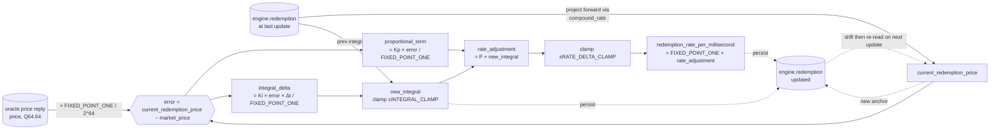

# Stablecoin Program — RFP-013 specification

**RFP:** [RFP-013 Reflexive Stablecoin Protocol](https://github.com/logos-co/rfp/blob/master/RFPs/RFP-013-reflexive-stablecoin-protocol.md)

**Verified against:** the stablecoin program on `refactor/stablecoin-lez-v0.4`, LEZ
`v0.4.0-rc3` (LEZ's actor model). The end-to-end tests in
`programs/integration_tests/tests/stablecoin.rs` run every conversation below through the
real guests.

This is the program's specification: its actors and state, the messages it accepts, who may
send them, the conversations each message starts, and the math behind them. It is written for
a reader who knows the v0.2.5 program (accounts, instructions, chained calls) but not LEZ's
actor model; §15 lists what changed.

> **A program is its address.** The stablecoin is addressed by the header account it was
> deployed to, and every stablecoin PDA (engine, stablecoin definition, surplus holding,
> vaults) derives from that id. A redeploy is a new, empty program: initialize it again and
> update every client value that depends on the program id.

## Table of contents

1. [Overview](#1-overview)
2. [Architectural decisions](#2-architectural-decisions)
3. [Actors](#3-actors)
    - [3.1 Actors and addresses](#31-actors-and-addresses)
    - [3.2 How it all works](#32-how-it-all-works)
    - [3.3 Reading the clock and the oracle](#33-reading-the-clock-and-the-oracle)
4. [State](#4-state)
    - [4.1 `StablecoinState`](#41-stablecoinstate)
    - [4.2 `Engine`](#42-engine)
    - [4.3 `ProtocolParameters`](#43-protocolparameters)
    - [4.4 `StabilityFeeAccumulator`](#44-stabilityfeeaccumulator)
    - [4.5 `RedemptionPriceState`](#45-redemptionpricestate)
    - [4.6 `Position`](#46-position)
    - [4.7 `Pending`](#47-pending)
    - [4.8 The oracle's price](#48-the-oracles-price)
    - [4.9 Encoding and versioning](#49-encoding-and-versioning)
5. [Constants and conventions](#5-constants-and-conventions)
    - [5.1 Fixed point](#51-fixed-point)
    - [5.2 `compound_rate`](#52-compound_rate)
    - [5.3 Current value projections](#53-current-value-projections-read-on-the-hot-path)
    - [5.4 Wall-clock time](#54-wall-clock-time)
6. [Math](#6-math)
    - [6.1 Nominal debt](#61-nominal-debt)
    - [6.2 Collateralization invariant](#62-collateralization-invariant)
    - [6.3 Normalized-debt deltas with directional rounding](#63-normalized-debt-deltas-with-directional-rounding)
    - [6.4 PI controller](#64-pi-controller-updateredemptionrate)
    - [6.5 Debt-accrual terminology](#65-debt-accrual-terminology-quick-reference)
    - [6.6 Fee accrual and the surplus mint](#66-fee-accrual-and-the-surplus-mint)
    - [6.7 Debt limits and aggregate accounting](#67-debt-limits-and-aggregate-accounting)
7. [Invariants](#7-invariants)
8. [Bound choices](#8-bound-choices)
9. [Messages and authorization](#9-messages-and-authorization)
    - [9.1 Messages](#91-messages)
    - [9.2 Internal messages](#92-internal-messages)
    - [9.3 Authorization rules](#93-authorization-rules)
    - [9.4 Routing](#94-routing)
    - [9.5 Declared actors and signers](#95-declared-actors-and-signers)
10. [Conversations](#10-conversations)
    - [10.1 `Initialize`](#101-initialize)
    - [10.2 `AccrueStabilityFee`](#102-accruestabilityfee)
    - [10.3 `UpdateRedemptionRate`](#103-updateredemptionrate)
    - [10.4 `RefreshGlobals`](#104-refreshglobals)
    - [10.5 `OpenPosition`](#105-openposition)
    - [10.6 `DepositCollateral`](#106-depositcollateral)
    - [10.7 `WithdrawCollateral`](#107-withdrawcollateral)
    - [10.8 `GenerateDebt`](#108-generatedebt)
    - [10.9 `RepayDebt`](#109-repaydebt)
    - [10.10 `ClosePosition`](#1010-closeposition)
    - [10.11 Admin setters](#1011-admin-setters)
    - [10.12 `SetDebtLimits`](#1012-setdebtlimits)
    - [10.13 `SetStabilityFeePerMillisecond`](#1013-setstabilityfeepermillisecond)
    - [10.14 `Freeze` / `Unfreeze`](#1014-freeze--unfreeze)
    - [10.15 `ResetRedemptionRateController`](#1015-resetredemptionratecontroller)
11. [Events](#11-events)
12. [Edge cases](#12-edge-cases)
13. [Out of scope](#13-out-of-scope-per-rfp)
14. [Forward integration](#14-forward-integration)
15. [Changes from the v0.2.5 program](#15-changes-from-the-v025-program)
16. [Known limitations and follow-ups](#16-known-limitations-and-follow-ups)
17. [Sample scenarios](#17-sample-scenarios)
    - [17.1 Alice's full lifecycle](#171-alices-full-lifecycle)
    - [17.2 Emergency freeze](#172-emergency-freeze)
    - [17.3 Redemption price & controller walkthrough](#173-redemption-price--controller-walkthrough)

---

## 1. Overview

RFP-013 asks for a non-pegged, reflexive stablecoin on LEZ modelled on RAI / Reflexer. The protocol mints stablecoin against collateralized debt positions ("SAFEs" in RAI's vocabulary), tracks debt via a normalized-debt + accumulator pattern so a single global update applies interest to every position without per-position writes, and continuously drifts a redemption price via a PI feedback controller fed by the deviation between the stablecoin's market price and the protocol's redemption price.

This document specifies the **on-chain program**. The CLI, mini-app, and SDK (RFP-013's other deliverables) are specified separately.

## 2. Architectural decisions

| Decision | Choice | Rationale |
|---|---|---|
| Instance model | One deployed header account id = one stablecoin + one collateral | Identical bytecode deployed at another header is an independent instance with its own PDAs and its own stablecoin. |
| Global state | One **engine** actor on one PDA holds the parameters, the fee accumulator, the redemption price and the operation in flight | A handler sees only its own actor's state. Every operation that needs the parameters, the accumulator and the price together runs at the engine, so they live in one state. |
| Position placement | A position is the stablecoin's actor state **on the owner's own account**; one per account | The owner's signature authorizes the owner's actor, so owner checks happen where the position is. No position PDA, no nonce: the position's id is the owner's account id. |
| Stablecoin ownership | The stablecoin definition is a token-program actor on a stablecoin PDA and is its own mint authority | Only the stablecoin program can grant that PDA's seed, so only it can mint (§10.8, §6.6). |
| Launch | RAI-style: the market price only steers the redemption rate | `Initialize` sets the redemption price and may name an oracle that does not exist yet. Borrowing never reads the market price, so the protocol works from day one; the controller waits (rate `1.0`) until the oracle exists. See "Day 0" in §3.2. |
| Price model | Single oracle quoting stablecoin in collateral units; redemption price in collateral-per-stablecoin | One oracle read per controller tick. Closed-loop unit system; no external reference asset. Single point of failure mitigated by the staleness gate and the freeze authority. |
| Fee accrual | RAI accumulator with surplus mint (`SAFEEngine.updateAccumulatedRate`) | Fees grow as the `accumulated_rate` multiplier, and every accrual mints `total_normalized_debt × Δaccumulator` to the protocol's surplus holding (§6.6). Supply keeps pace with total nominal debt (RFP R1); `GenerateDebt` / `RepayDebt` accrue first, like RAI's proxies calling `taxSingle`. |
| Rate plumbing | Lazy globals + permissionless pokes | Positions store normalized debt; the engine projects the accumulator and the redemption price to "now" on demand. Pokes (`AccrueStabilityFee`, `UpdateRedemptionRate`, `RefreshGlobals`) re-anchor them and need no signature. |
| Authority model | The program's own account initializes; the admin and the freeze authority are stored in `ProtocolParameters` and act through their own accounts | The deployer chooses the initial authorities at `Initialize`. Afterwards each role signs a message to its own account (its **seat**), which forwards it to the engine (§9.3). |
| Oracle producer | Configurable price actor and program, set together | The engine accepts a price reply only from the configured `(market_price_oracle_id, market_price_oracle_program_id)` actor and checks the quoted pair on every reply. An aggregator can be configured as the producer. |

**Collateral is the reference unit.** For a collateral-denominated stablecoin value,
`stablecoin/reference = stablecoin/collateral × collateral/reference`, where each
term means the value of one unit in the second asset. Holding the first factor
fixed passes the collateral's proportional external-price change through to that
valuation. This identity does not guarantee that the stablecoin's traded market
price follows it. The health check (§6.2) has no direct external collateral-price
input: an external price crash alone does not change its result when its inputs
stay fixed. Fee growth, changes to the required ratio, redemption-price drift,
and indirect market/controller responses can still change position health. A
future liquidation design must account for this reference-unit limitation;
this program does not add an external-reference-asset oracle.

## 3. Actors

An **actor** is an account under a program, written `ACCOUNT@PROGRAM`. An account holds one
state per program, so `alice@stablecoin` (Alice's position) and `alice@token` (a token holding
on Alice's account) are different actors. A message goes to one actor; the handler sees that
actor's state and nothing else. It cannot read another account or another program's state:
everything else is learned from messages, and every multi-party step is a **conversation**,
a sequence of messages between actors in one transaction.

### 3.1 Actors and addresses

The stablecoin program's actors:

| Actor | Account | State |
|---|---|---|
| **Engine** | the engine PDA | `StablecoinState::Engine` (§4.2): parameters, fee accumulator, redemption price, the pending operation |
| **Position** | the owner's own account | `StablecoinState::Position` (§4.6), or empty when the account has no position |
| **Seat** | the admin's or the freeze authority's own account | whatever is there; a seat only forwards and never changes it |
| **Program account** | the program's header account | none; it is the root of `Initialize` |
| **Surplus relay** | the surplus-holding PDA | none; it relays one message during `Initialize` (§10.1) |

The token-program actors on stablecoin PDAs:

| Actor | What it is |
|---|---|
| **Stablecoin definition** (`definition@token`) | the stablecoin's token definition, created by `Initialize` with supply 0 and **itself** as mint authority |
| **Surplus holding** (`surplus@token`) | a stablecoin holding that receives every accrued fee (§6.6) and through which every repayment is burned (§10.9) |
| **Vault** (`vault@token`, one per owner) | a collateral holding that custodies one position's collateral |

Every PDA is `AccountId::for_public_pda(program_id, seed)`, where `program_id` is the
stablecoin's header account id and each seed is a SHA-256 hash:

| PDA | Seed pre-image | Helper (`stablecoin_core`) |
|---|---|---|
| engine | `"STABLECOIN__PROTOCOL_PARAMS_____"` (32 bytes) | `compute_engine_pda` |
| stablecoin definition | `"STABLECOIN__DEFINITION__________"` (32 bytes) | `compute_stablecoin_definition_pda` |
| surplus holding | `"STABLECOIN__MASTER_HOLDING______"` (32 bytes) | `compute_surplus_holding_pda` |
| vault | `owner_account_id` (32 bytes) ‖ `"POSITION_VAULT"` | `compute_position_vault_pda` |

The three fixed seeds are unchanged from v0.2.5, which is why their text still carries the
v0.2.5 names. Each helper has a `*_seed` twin that returns the `PdaSeed` the program grants. To
print the addresses of a deployment:

```bash
cargo run -q -p stablecoin_program --example stablecoin_pdas -- \
  <stablecoin_program_id> [<owner_account_id>]
```

It prints the engine, the stablecoin definition, the surplus holding and, with an owner, that
owner's vault.

Two actors outside the program take part:

- **the clock actor**, `clock_core::clock_actor()`, which answers the engine's time reads (§5.4);
- **the oracle's price actor**, `market_price_oracle_id@market_price_oracle_program_id`, which
  answers the engine's price reads (§4.8).

The collateral token's definition and the users' holdings (collateral and stablecoin) are
ordinary token actors. The program never reads them; it sends them token messages.

```mermaid
flowchart TB
    subgraph SC["stablecoin program"]
        Engine[engine PDA<br/>Engine state]
        Pos[owner@stablecoin<br/>Position state]
        Seat[admin / freeze authority<br/>@stablecoin, seat]
        Prog[program account<br/>Initialize root]
    end
    subgraph TK["token program"]
        Def[stablecoin definition<br/>own mint authority]
        Surplus[surplus holding]
        Vault[vault, one per owner]
        Holdings[user holdings<br/>collateral, stablecoin]
    end
    Clock[clock actor]
    Oracle[oracle price actor]

    Pos -- requests --> Engine
    Engine -- replies --> Pos
    Seat -- Admin --> Engine
    Prog -- InitializeEngine --> Engine
    Engine -- ReadTimestamp --> Clock
    Engine -- ReadPrice --> Oracle
    Engine -- Mint / Burn / Transfer --> Def
    Engine -- Burn --> Surplus
    Pos -- InitializeHolding / Transfer --> Vault
    Pos -- Transfer --> Holdings
```

### 3.2 How it all works

A walkthrough of who sends what. The exact message sequences are in §10.

**Day 0 — setup.** The deployer deploys the binary to a header account whose key they hold,
then sends `Initialize` (§10.1) to the program's own actor, signed by the header account. That
one transaction creates the stablecoin definition (supply 0, its own mint authority) with the
surplus holding as its first holding, and writes the engine: the chosen admin and freeze
authority, the token program, the collateral definition, the oracle, the initial redemption
price, fee rate, controller gains, safety ratio, timing parameters, and the explicit position
debt floor and global debt ceiling. Aggregate normalized debt starts at zero. The selected
admin need not sign.

**Day 0 — launching before a market exists (as RAI does).** The stablecoin has no market price
until someone trades it, and the TWAP oracle that will report that price can only be created
from an AMM pool that holds stablecoin. The protocol breaks that circle the way RAI does: the
deployer fixes the starting redemption price, and the market price only ever *steers* it.

1. Send `Initialize` with the address and program of the price actor that will exist later —
   typically the AMM pool's TWAP price PDA, which is predictable from the pool's token
   definitions. It does not need to exist (§10.1).
2. Users open positions and borrow straight away. Minting never reads the oracle (§10.8);
   collateralization uses the redemption price.
3. Keepers send `RefreshGlobals { consult_oracle: false }`, which accrues fees and leaves the
   controller alone. `UpdateRedemptionRate`, and `RefreshGlobals { consult_oracle: true }` once
   its interval is due, fail: LEZ refuses a transaction that reaches a price actor that does not
   exist (§10.3). The rate stays `1.0`, so the redemption price holds at its initial value.
4. Someone seeds the AMM pool with minted stablecoin and collateral and creates the pool's
   oracle at the configured address. From then on keepers send
   `RefreshGlobals { consult_oracle: true }` and the controller runs.

If the final address is not known at launch, configure a placeholder and change both ids with
`SetMarketPriceOracle` when it is. An empty address, including a PDA, is not reserved: another
party can create something there. Only a reply from the configured actor is accepted, and every
reply's pair is checked, so a squatter cannot steer the rate; but a `ReadPrice` at it can fail,
which blocks the controller until the admin configures another oracle. Fee accrual stays
available through `consult_oracle: false`.

**Running the protocol — keepers advance the globals.** Three messages anyone can send to the
engine, with no signature, keep the globals current:

- `AccrueStabilityFee` (§10.2) advances the global fee multiplier and mints the accrued fees to
  the surplus holding.
- `UpdateRedemptionRate` (§10.3) reads the oracle, runs the PI controller (§6.4) and re-anchors
  the redemption price and its drift rate. It is strict: an unusable price fails it.
- `RefreshGlobals { consult_oracle }` (§10.4) does both in one transaction, best-effort: it
  always accrues, and runs the controller only when asked, when the interval is due and when
  the price is usable.

They cost fees and earn no reward — anyone with money in the protocol wants the globals fresh.

**A user opens a position and borrows.** The user sends `OpenPosition` (§10.5) to their own
stablecoin actor, signed by their account. The engine approves unless the protocol is frozen,
the position is written on the user's account, a vault (a collateral holding on a stablecoin
PDA derived from the owner) is initialized, and the initial collateral moves into it. The user
then sends `GenerateDebt` (§10.8) to mint stablecoin into a stablecoin holding. The engine
accrues fees, prices the new debt, checks the debt floor, the debt ceiling and
collateralization, and mints.

**Time passes; debt grows; users adjust.** As fees accrue, every position's debt grows though
no position is written (the RAI accumulator, §6.1). Users can:

- `DepositCollateral` (§10.6) to add collateral and improve the ratio.
- `WithdrawCollateral` (§10.7) to take some back — indebted positions must stay above the safety
  ratio and cannot withdraw while frozen. Positions with exactly zero normalized debt may
  withdraw while frozen.
- `RepayDebt` (§10.9) to burn stablecoin and lower the debt. To pay off accrued interest, users
  may need to buy extra stablecoin on the market.

**Closing out.** When a position's debt and collateral are both zero, `ClosePosition` (§10.10)
empties the owner's stablecoin actor. The empty vault holding stays; opening again on the same
account re-initializes it, which the token treats as a no-op.

**Admin tunes parameters.** The admin can change the stability fee (pending interest accrues at
the old rate first, so the new rate is never retroactive), the collateralization ratio, the
controller gains, the oracle, the timing intervals and the debt limits, and rotate the admin
and freeze-authority roles. None of these touch a position. The admin cannot touch a position,
mint or burn stablecoin, set the redemption price, or change the token program, the stablecoin
definition or the collateral definition — those are fixed at `Initialize`. The admin or the
freeze authority can return the controller to rest (`ResetRedemptionRateController`, §10.15):
the rate goes back to `1.0` and the integral to `0`, but the price stays where it currently
projects.

**Emergency.** If something goes wrong (a broken oracle, an exploit in progress), the freeze
authority sends `Freeze` (§10.14), which sets `is_frozen`. After that, `OpenPosition`,
`GenerateDebt`, and withdrawals from positions with nonzero normalized debt fail. An owner whose
position has exactly zero normalized debt may still withdraw some or all collateral.
`DepositCollateral`, `RepayDebt`, `ClosePosition`, the pokes and admin changes remain available,
so users can pay down debt and leave, and operators can fix the problem. This deliberately
permits debt-free collateral to leave during an emergency: the freeze authority stops
debt-increasing paths and withdrawals backing debt, but cannot hold a debt-free owner's
collateral until unfreeze. The admin may configure a clean oracle with `SetMarketPriceOracle`,
and the freeze authority sends `Unfreeze` to resume.

### 3.3 Reading the clock and the oracle

A handler cannot read another actor; it asks, and the answer arrives as a new message that runs
the handler again. A reply carries no context of its own, so before the engine asks, it writes
the operation it is in the middle of into its own state, in the `pending` slot (§4.7), and
reads it back when the reply arrives. This is called **parking**. The engine parks one
operation at a time: asking while something is parked fails with
`"the engine is already waiting for a reply"`. Every transaction either finishes the parked
operation (the reply clears `pending`) or fails as a whole, so `pending` is empty between
transactions.

The clock and the oracle are the only actors the engine asks. Token messages need no reply.

## 4. State

All types live in `stablecoin_core`. They are Borsh-encoded on chain; the field order shown is
the stored layout.

### 4.1 `StablecoinState`

```rust
pub enum StablecoinState {
    Engine(Engine),
    Position(Position),
}
```

The stablecoin's state on one account. An empty actor state means "nothing here" and is not a
`StablecoinState`: an account without a position, or an engine before `Initialize`.
`StablecoinState::decode` returns `None` for empty bytes and panics with
`"stablecoin state must decode"` on anything else that does not decode (only stablecoin code
writes stablecoin state).

### 4.2 `Engine`

```rust
pub struct Engine {
    pub parameters: ProtocolParameters,      // §4.3
    pub fee: StabilityFeeAccumulator,        // §4.4
    pub redemption: RedemptionPriceState,    // §4.5
    pub pending: Option<Pending>,            // §4.7; None between transactions
}
```

One engine per deployment, at the engine PDA (§3.1).

### 4.3 `ProtocolParameters`

| # | Field | Type | Meaning | Changed by |
|---|---|---|---|---|
| 1 | `admin_account_id` | `AccountId` | authority for every setter and admin rotation | `SetAdmin` |
| 2 | `freeze_authority_account_id` | `AccountId` | authority for `Freeze` / `Unfreeze` | `SetFreezeAuthority` |
| 3 | `token_program_id` | `AccountId` | the token program of the stablecoin, the collateral, the vaults and every holding the program touches | **immutable** |
| 4 | `stablecoin_definition_id` | `AccountId` | the stablecoin definition PDA | **immutable** (changing it would break supply accounting against the existing float) |
| 5 | `collateral_definition_id` | `AccountId` | the single accepted collateral | **immutable** (changing it would orphan every vault) |
| 6 | `market_price_oracle_id` | `AccountId` | the account of the oracle's price actor | `SetMarketPriceOracle` |
| 7 | `market_price_oracle_program_id` | `AccountId` | the program that price actor belongs to | `SetMarketPriceOracle` |
| 8 | `stability_fee_per_millisecond` | `u128` | per-millisecond fee multiplier, `(1 + r) × FIXED_POINT_ONE` | `SetStabilityFeePerMillisecond` |
| 9 | `controller_proportional_gain` | `i128` | PI controller `Kp` (non-negative, §8) | `SetControllerGains` |
| 10 | `controller_integral_gain` | `i128` | PI controller `Ki` (non-negative, §8) | `SetControllerGains` |
| 11 | `minimum_collateralization_ratio` | `u128` | fixed point; `1.5 × FIXED_POINT_ONE` = 150% | `SetMinimumCollateralizationRatio` |
| 12 | `minimum_milliseconds_between_rate_updates` | `u64` | minimum interval between controller ticks (RFP F2) | `SetTimingParameters` |
| 13 | `maximum_oracle_price_age_milliseconds` | `u64` | oracle staleness gate (RFP R3) | `SetTimingParameters` |
| 14 | `is_frozen` | `bool` | blocks `OpenPosition`, `GenerateDebt` and withdrawals from indebted positions | `Freeze` / `Unfreeze` |
| 15 | `minimum_debt_amount` | `u128` | position debt floor, raw stablecoin units (§6.7) | `SetDebtLimits` |
| 16 | `debt_ceiling` | `u128` | global borrowing ceiling, raw stablecoin units (§6.7) | `SetDebtLimits` |

### 4.4 `StabilityFeeAccumulator`

| Field | Type | Meaning |
|---|---|---|
| `accumulated_rate_at_last_accrual` | `u128` | the accumulator at `last_accrued_at`; starts at `FIXED_POINT_ONE`, never decreases |
| `last_accrued_at` | `u64` | Unix milliseconds of the last accrual |
| `total_normalized_debt` | `u128` | Σ every position's `normalized_debt_amount` (RAI's `debtAmount`); kept in step by `GenerateDebt` / `RepayDebt` |

The current accumulator at `now` is
`accumulated_rate_at_last_accrual × compound_rate(stability_fee_per_millisecond, now − last_accrued_at) / FIXED_POINT_ONE` (§5.3).

### 4.5 `RedemptionPriceState`

| Field | Type | Meaning |
|---|---|---|
| `redemption_price_at_last_update` | `u128` | the redemption price at `last_updated_at`, collateral per stablecoin, fixed point |
| `redemption_rate_per_millisecond` | `u128` | per-millisecond drift multiplier, `(1 + r) × FIXED_POINT_ONE`; below `FIXED_POINT_ONE` is decay; written by the controller |
| `controller_integral_term` | `i128` | the PI controller's integral, clamped against windup (§6.4) |
| `last_updated_at` | `u64` | Unix milliseconds of the last controller tick, reset or `Initialize` |

The current price at `now` is
`redemption_price_at_last_update × compound_rate(redemption_rate_per_millisecond, now − last_updated_at) / FIXED_POINT_ONE` (§5.3).

### 4.6 `Position`

| Field | Type | Meaning |
|---|---|---|
| `token_program_id` | `AccountId` | the token program the vault lives in, pinned when the position opened |
| `collateral_amount` | `u128` | collateral moved into the vault and not withdrawn, raw collateral units |
| `normalized_debt_amount` | `u128` | debt divided by the accumulator at the time it was taken: nominal debt is `normalized_debt_amount × accumulator / FIXED_POINT_ONE` (§6.1) |

A position lives on its owner's account, so the owner is the account itself: there is no owner
field, no nonce, and no stored vault id (the vault derives from the owner, §3.1). The position
trusts its own `collateral_amount`; the vault's balance is never read (§7 invariant 1).

### 4.7 `Pending`

What the engine is waiting on (§3.3). One at a time.

| Variant | Parked by | Waiting for |
|---|---|---|
| `Initialize` | §10.1 | the clock |
| `AccrueStabilityFee` | §10.2 | the clock |
| `UpdateRedemptionRate` | §10.3 | the clock |
| `RefreshGlobals { consult_oracle }` | §10.4 | the clock |
| `SetStabilityFee { new_rate }` | §10.13 | the clock |
| `ResetController` | §10.15 | the clock |
| `GenerateDebt { position, amount, to, collateral_amount, normalized_debt_amount }` | §10.8 | the clock |
| `RepayDebt { position, maximum_amount, from_holding, normalized_debt_amount }` | §10.9 | the clock |
| `Withdraw { position, amount, to, collateral_after, normalized_debt_amount }` | §10.7 | the clock |
| `OraclePrice { now, hard }` | §10.3, §10.4 | the oracle; `now` is the clock time already read; `hard` makes an unusable price a failure |

`position` is the requesting owner's account id. The position's amounts travel in the request
because the engine cannot read the position.

### 4.8 The oracle's price

The oracle replies to `twap_oracle_core::ReadPrice` with a `twap_oracle_core::PriceReply { price }`,
where `price` is an `OraclePrice` (base/quote asset ids, price, observation timestamp, and the
source's metadata). The engine uses it only when, in this order:

1. `base_asset == stablecoin_definition_id` and `quote_asset == collateral_definition_id`;
2. `timestamp ≤ now` (not dated in the future);
3. `now − timestamp ≤ maximum_oracle_price_age_milliseconds`;
4. `price > 0`.

An observation stamped exactly `now`, or exactly at the maximum age, is usable.

**Scale:** `price` is `Q64.64` (`price / 2^64` raw collateral units per raw stablecoin unit;
`twap_oracle_core::PRICE_FRACTIONAL_BITS`), not `FIXED_POINT_ONE`-scaled. Every producer must
use this encoding. The controller converts it with `oracle_price_to_fixed_point`
(`price × FIXED_POINT_ONE / 2^64`, rounded down, saturating at `u128::MAX`) before comparing it
with the redemption price (§6.4).

### 4.9 Encoding and versioning

State and messages are Borsh. Integers are little-endian with no padding. Every enum
(`StablecoinState`, `Message`, `Internal`, `AdminAction`, `Pending`) is **append-only**: Borsh
writes a variant's index as its first byte, and state and in-flight messages outlive code, so a
changed layout must be a new variant, never an edit of an existing one. That is the program's
versioning; the state carries no version field.

The IDL, `artifacts/stablecoin-idl.json`, is generated from `stablecoin_core` by `make idl` and
lists the messages, the state types and the events.

## 5. Constants and conventions

### 5.1 Fixed point

```rust
/// The value 1.0 in our 27-decimal fixed-point representation.
/// Every rate, ratio, and price-multiplier field stores `actual_value * FIXED_POINT_ONE`.
pub const FIXED_POINT_ONE: u128 = 10u128.pow(27);
```

The 27-decimal choice matches MakerDAO / RAI's `RAY` precision. Representable
compounding intervals still depend on the rate and anchor; the permitted
parameter extremes can overflow or project a decaying price to zero (§5.2–§5.3).

- All multiplications of fixed-point values use `u256` (`i256` for signed) intermediates to avoid overflow; results are reduced back to `u128` / `i128` after dividing by `FIXED_POINT_ONE`. The §6.2 collateralization check is the exception: it compares in `u512` and never reduces (§6.2).
- Minting rounds the normalized-debt increment up; repayment rounds the decrement down (§6.3).
- Unsigned compounding and projection divisions floor at each intermediate step, so projected accumulators and prices can fall below exact real arithmetic. The error is not uniformly negligible across all permitted rates and elapsed windows.
- Signed controller divisions truncate toward zero. Their effect depends on the signs and controller state; there is no universal rounding beneficiary.

### 5.2 `compound_rate`

```rust
/// Returns `per_millisecond_rate ^ milliseconds_elapsed` in fixed point (where `1.0 == FIXED_POINT_ONE`).
///
/// O(log milliseconds_elapsed) — exponentiation by squaring. Uses u256 intermediates.
/// Same algorithm as MakerDAO / RAI's `rpow`.
pub fn compound_rate(per_millisecond_rate: u128, milliseconds_elapsed: u64) -> u128;
```

Edge cases:

- `milliseconds_elapsed = 0` → returns `FIXED_POINT_ONE` (identity element).
- `per_millisecond_rate = FIXED_POINT_ONE` → returns `FIXED_POINT_ONE` regardless of `milliseconds_elapsed`.
- `per_millisecond_rate < FIXED_POINT_ONE` → result < `FIXED_POINT_ONE` (compounding decay).
- Overflow guard: callers clamp the elapsed window to `MAXIMUM_COMPOUNDING_WINDOW_MILLISECONDS` before calling (§5.3). This is load-bearing, not decorative: over an *unbounded* window, any `per_millisecond_rate > FIXED_POINT_ONE` eventually overflows `rate ^ milliseconds_elapsed` regardless of how close to `1.0` it is — the §8 rate bound alone does **not** prevent it.
- **The clamp bounds the window; it does not make overflow impossible on its own.**
  The §8 rate bounds do the rest. For the redemption price, `RATE_DELTA_CLAMP`
  (`±10^-11` per ms) and `MAXIMUM_REDEMPTION_PRICE` (`u128::MAX / 2`) keep a full
  window inside `u128`: at the clamp the price grows by at most ~0.6% over seven
  days. For the fee accumulator, `MAXIMUM_STABILITY_FEE_PER_MILLISECOND` (about
  100% a year) grows it by at most ~1.3% per window, and from `1.0` it needs about
  38 years at the maximum fee to approach `u128::MAX`. Values that are only ever
  **compared** still use the saturating `u512` projections of §5.3, and the
  redemption-price re-anchor (§6.4, §10.15) projects in `u512` and clamps, so
  extreme states cannot panic those paths.

**In plain English:** this is just `rate ^ milliseconds_elapsed` — what a per-millisecond multiplier becomes after that many milliseconds. The naive way is `milliseconds_elapsed` separate multiplications. Exponentiation-by-squaring does it in `log₂(milliseconds_elapsed)` multiplications instead — for a year's worth of milliseconds (~31.5 billion), that's ~35 muls instead of 31.5 billion.

### 5.3 Current value projections (read on the hot path)

```rust
// Used in every operation that needs the up-to-date accumulator / redemption price.
fn current_accumulated_rate(state: StabilityFeeAccumulator, params: ProtocolParameters, now: u64) -> u128 {
    // Clamp the elapsed window. Over an unbounded dt, any rate > 1 eventually overflows
    // compound_rate (§5.2, §8). The cap bounds the worst case structurally, independent of
    // the rate value. Trade-off: fees stop accruing past the window if NO keeper pokes for
    // that long — permissionless, cheap accrue makes this a catastrophic-neglect-only case.
    let dt = now.saturating_sub(state.last_accrued_at).min(MAXIMUM_COMPOUNDING_WINDOW_MILLISECONDS);
    let factor = compound_rate(params.stability_fee_per_millisecond, dt);
    mul_div(state.accumulated_rate_at_last_accrual, factor, FIXED_POINT_ONE)
}

fn current_redemption_price(state: RedemptionPriceState, now: u64) -> u128 {
    // Same clamp rationale as above — redemption_rate_per_millisecond can also exceed 1.0.
    let dt = now.saturating_sub(state.last_updated_at).min(MAXIMUM_COMPOUNDING_WINDOW_MILLISECONDS);
    let factor = compound_rate(state.redemption_rate_per_millisecond, dt);
    mul_div(state.redemption_price_at_last_update, factor, FIXED_POINT_ONE)
}
```

Where `mul_div(a, b, c) = (a * b) / c` computed via u256 to avoid intermediate overflow.

**Wide variants for the §6.2 check.** Both projections above return `u128` and so
panic at the rate ceilings §8 permits (§5.2). The collateralization check only ever
*compares* these values, so it consumes `current_accumulated_rate_wide` and
`current_redemption_price_wide` instead: identical `dt` clamp and compounding, but
computed in `u512` with **saturating** multiplication rather than panicking. Saturating
is the safe direction — §6.2's left-hand side cannot exceed `u128::MAX ×
FIXED_POINT_ONE^3` (~`10^119`), while the smallest value these can saturate to is
~`10^127`, so a saturated projection always loses the comparison, which is the correct
answer for debt whose value has outgrown the type. The redemption-price re-anchor in §10.3 and §10.15
also uses the wide projection, clamped into the §8 price bounds, so it never panics.
The `u128` accumulator remains in use where the result is **stored** (every accrual, §6.6) and
where it divides a borrowed amount (§10.8).

**In plain English:** instead of writing "current_accumulator = X" into every position on every fee tick, the engine stores an **anchor** plus the **per-millisecond rate**, and computes the current value on the fly by rolling the anchor forward via `compound_rate`. Reads are slightly more expensive (one `compound_rate` call); writes happen only on real anchor updates (accruals, §6.6, and controller ticks, §10.3).

### 5.4 Wall-clock time

Every `now` in this document is a Unix **millisecond** timestamp from the clock actor
(`clock_core::clock_actor()`). The engine sends it
`clock_core::Message::ReadTimestamp { granularity: 1 }` as a sync message and receives
`clock_core::Reply::Timestamp(now)`: the previous block's timestamp, unrounded. The engine
parks the operation before it asks (§3.3) and finishes it in the reply. A clock reply is
accepted only from the clock actor, only at the engine, and only while a clock read is parked
(`"the engine is not waiting for the clock"`); any other clock reply fails with
`"the stablecoin reads only the clock's timestamp"`.

Conversations that read the clock: `Initialize`, the three pokes, `GenerateDebt`, `RepayDebt`,
`WithdrawCollateral` (only for a non-zero amount from an indebted position),
`SetStabilityFeePerMillisecond` and `ResetRedemptionRateController`. Those that do not:
`OpenPosition`, `DepositCollateral`, `ClosePosition`, `Freeze` / `Unfreeze`, and every other
setter. A transaction that reads the clock must declare the clock actor (§9.5).

## 6. Math

### 6.1 Nominal debt

Always derived; never stored.

```
nominal_debt(position, now) = position.normalized_debt_amount * current_accumulated_rate(fee, parameters, now) / FIXED_POINT_ONE
```

**In plain English:** this is the "RAI trick" for accruing fees without rewriting every position on every fee tick. Think of `normalized_debt_amount` as **shares in a debt pool whose "value per share" is the accumulator**. Mint 100 stablecoins when the accumulator is `1.0` → you hold 100 "shares". When the accumulator later grows to `1.05` (5% accrued), you owe 105 — same shares, higher value per share, **no write to your position ever happened**. One global accumulator update applies interest to every position at once. The formula just unwinds shares back to the real number.

### 6.2 Collateralization invariant

For every operation that could decrease collateral or increase debt, enforced on the result:

```
collateral_value_in_stablecoin = position.collateral_amount * FIXED_POINT_ONE / current_redemption_price(now)
required_collateral_in_stablecoin = nominal_debt * minimum_collateralization_ratio / FIXED_POINT_ONE
assert collateral_value_in_stablecoin >= required_collateral_in_stablecoin
```

Equivalent, and the form actually checked, with the nominal-debt division folded in so the
comparison is exact (flooring the nominal debt first would tilt it toward the borrower):

```
assert position.collateral_amount * FIXED_POINT_ONE^3
       >= normalized_debt * current_accumulator * current_redemption_price * minimum_collateralization_ratio
```

Both sides computed in `u512`, not `u256`: `collateral_amount × FIXED_POINT_ONE^2`
alone exceeds `u256` once collateral passes ~115_792 whole tokens at 18 decimals. The
right-hand side multiplies with **saturating** arithmetic, and the projections arrive
as the `u512` wide variants of §5.3 — so a projection that has outgrown `u128` yields
`"Position is undercollateralized"` rather than a panic on overflow. A redemption price that
projects to **zero** is rejected outright before the comparison
(`"Redemption price projected to zero"`): zero would zero the requirement and let an
indebted position be drained completely. A position with zero normalized debt always passes.

Applied in: `WithdrawCollateral` (on the collateral left), `GenerateDebt` (on the new debt).
NOT applied in: `DepositCollateral` (strictly improves it), `RepayDebt` (strictly improves it).

**In plain English:** a position is healthy if your collateral is worth enough to cover your debt PLUS a safety buffer. To compare apples to apples, we convert your stablecoin debt into collateral units using the current redemption price (`redemption_price` is "collateral per stablecoin"). Then we require: `collateral ≥ debt-in-collateral-units × safety_ratio`. With ratio = 1.5, you need 1.5× the collateral-value of your debt. Going below 1.0× would mean immediate insolvency (no buffer left); liquidation lives in RFP-014.

### 6.3 Normalized-debt deltas with directional rounding

Borrowing increases normalized debt by
`ceil(amount * FIXED_POINT_ONE / current_accumulator)`: the borrower receives
exactly `amount`, so the corresponding exact nominal debt must grow by at least
that much.

For repayment, `RepayDebt`'s `maximum_amount` is the **maximum burn the owner authorizes**.
Let `M` be that maximum, `N` the current normalized debt, `A` the accumulator accrued to the
execution-time clock (§6.6), and `R = FIXED_POINT_ONE`:

```text
full_cost = ceil(N * A / R)
actual_burn = min(M, full_cost)
normalized_decrement = N                    if M * R >= N * A
                       floor(M * R / A)     otherwise
normalized_debt_after = N - normalized_decrement
```

`stablecoin_core::math::compute_repayment` compares the products in `U256` before narrowing
results. It calculates `full_cost` as a `u128` only when the maximum covers it; partial
repayments remain possible even when the total nominal debt exceeds `u128::MAX`.

- **Partial repayment rounds the debt reduction DOWN.** It burns exactly `M`;
  the exact nominal debt reduction is at most `M`. A small positive burn can
  remove zero normalized units, preserving the existing dust behavior.
- **Full repayment rounds the burn UP.** It removes all `N` normalized units and
  burns only `ceil(N * A / R)`. The ceiling exceeds exact fractional debt by less
  than one raw token unit; the unused buffer remains in the user's holding.

Net effect: rounding never reduces exact debt by more than the amount burned,
so `Σ nominal_debt − total_supply` (§7 invariant 7) is never negative, and is
only integer dust. The dust always sticks to the protocol's side.

**Execution-time buffers.** A maximum computed from an earlier snapshot clears
the debt only if it covers the ceiling at execution. If fees push the debt above
the maximum, the transaction repays partially. Clients should reread the
position's debt and their token balances after the transaction before reporting closure or
actual spend.

### 6.4 PI controller (`UpdateRedemptionRate`)

```
// 1. Project current redemption price from the anchor (in u512, so it cannot
//    overflow), then clamp it into the §8 price bounds.
dt = now - state.last_updated_at
current_redemption_price = clamp(state.redemption_price_at_last_update
                                 * compound_rate(state.redemption_rate_per_millisecond, dt)
                                 / FIXED_POINT_ONE,
                                 MINIMUM_REDEMPTION_PRICE, MAXIMUM_REDEMPTION_PRICE)

// 2. Compute signed error.
//    oracle.price is Q64.64 (§4.8); convert it to the FIXED_POINT_ONE scale first.
//    error > 0 when redemption_price > market_price (protocol's target above market valuation).
market_price = oracle.price * FIXED_POINT_ONE / 2^64
error: i256 = (current_redemption_price as i256) - (market_price as i256)

// 3. Update integral state (clamped for anti-windup).
integral_delta = (params.controller_integral_gain as i256) * error * (dt as i256) / FIXED_POINT_ONE
new_integral = state.controller_integral_term + integral_delta
new_integral = clamp(new_integral, -INTEGRAL_CLAMP, INTEGRAL_CLAMP)

// 4. Compute rate adjustment.
proportional_term = (params.controller_proportional_gain as i256) * error / FIXED_POINT_ONE
rate_adjustment   = proportional_term + new_integral
//   No negation: with positive gains and no opposing standing integral, a positive
//   error pushes the rate UP and a negative error pushes it DOWN. Fixed-point
//   truncation can leave a small adjustment at zero. Market response is not guaranteed.

// 5. Clamp the rate adjustment (rate-explosion guard, RFP R2).
rate_adjustment = clamp(rate_adjustment, -RATE_DELTA_CLAMP, RATE_DELTA_CLAMP)
new_rate = (FIXED_POINT_ONE as i256 + rate_adjustment) as u128

// 5a. At a price bound the rate may only point back inside the band.
if current_redemption_price <= MINIMUM_REDEMPTION_PRICE: new_rate = max(new_rate, FIXED_POINT_ONE)
if current_redemption_price >= MAXIMUM_REDEMPTION_PRICE: new_rate = min(new_rate, FIXED_POINT_ONE)

// 6. Persist.
state.redemption_price_at_last_update = current_redemption_price
state.redemption_rate_per_millisecond      = new_rate
state.controller_integral_term        = new_integral
state.last_updated_at                 = now
```

The signs work out so that **positive gains drive the system toward stability** (negative feedback): with no negation on `rate_adjustment`, the correction carries the same sign as `error = redemption − market`, exactly matching RAI's `redemptionRate = RAY + (Kp·error + Ki·∫)`. Operators tune gain magnitude; the stabilizing direction is embedded in the controller, not the gain. That is why the §8 bands reject negative gains: a negative gain would be positive feedback and drive the redemption price away from the market.

`INTEGRAL_CLAMP` and `RATE_DELTA_CLAMP` are constants in v1 (§ 8). Promoting them to `ProtocolParameters` admin-tunable fields is a future revision (a new `StablecoinState` layout, §4.9).

**Anti-windup — clamp vs leak (deliberate divergence from RAI).** v1 bounds the integral with a hard clamp (`clamp(new_integral, ±INTEGRAL_CLAMP)`) — conditional integration / saturation. RAI instead uses a *leaky* integrator: it scales the accumulated deviation by a per-second decay factor (`rpow(perSecondCumulativeLeak, Δt)`) before adding the new term, so stale error fades exponentially rather than sitting pinned at a bound. Both are valid anti-windup. v1 picks the clamp because it's simpler, deterministic, and adds no extra parameter; the trade-off is *windup-on-release* — under a long sustained deviation the clamped integral saturates, whereas the leak never fully saturates. Setting `INTEGRAL_CLAMP = RATE_DELTA_CLAMP` keeps that lag short: a saturated integral exactly saturates the output, so the rate starts moving back as soon as the error reverses. A wound-up controller can also be reset outright (§10.15). This is a conscious choice, not an oversight; adopting RAI's leak is the planned upgrade once the controller is tuned against simulation (§16).

**In plain English.** The controller steers one number — the **redemption price**, the protocol's official value for the coin — so that the **market price** (from the oracle) is pulled toward it. It never moves the price directly; it sets the *speed and direction* the redemption price changes, the `redemption_rate_per_millisecond` (above `1.0` ⇒ price goes up over time, below `1.0` ⇒ down, exactly `1.0` ⇒ held).

It works from the gap, `error = redemption_price − market_price` (positive ⇒ coin trading below target, i.e. too cheap), and combines two reactions:

- **Proportional** — `Kp × error`, where `Kp` (`controller_proportional_gain`) is a fixed dial the operator sets for how strongly to react to the gap *right now*.
- **Integral** — a running memory (`controller_integral_term`, which **starts at `0` at launch**) that each update grows by `Ki × error × Δt`, where `Ki` (`controller_integral_gain`) is the dial for how strongly a gap that *won't go away* feeds in. The memory is what corrects small-but-persistent deviations that the proportional term alone would miss.

Their sum is the rate adjustment, added to `1.0`. Because there is **no negation**, the adjustment carries the same sign as `error`: too cheap ⇒ rate above `1.0` ⇒ redemption price goes up ⇒ holding the coin becomes more rewarding and minting tightens ⇒ market pulled **up** toward the target. Too expensive ⇒ the mirror image. As the market reaches the target, `error → 0`, the rate returns to `1.0`, and the price holds.

`Kp` and `Ki` are fixed dials (changed only by the admin via `SetControllerGains`); the memory and the rate are the parts that move. Two clamps bound the loop: `INTEGRAL_CLAMP` on the memory (anti-windup) and `RATE_DELTA_CLAMP` on a single update's adjustment. A fully worked numeric walkthrough — computing the rate, then projecting `current_redemption_price` at several times — is in §17.3.



### 6.5 Debt-accrual terminology (quick reference)

The same few names for the fee/debt machinery recur across §4, §5, and §6. Consolidated here.

**Stored values:**

- **`normalized_debt_amount`** — a position's debt with interest stripped out: its "shares." Lives in the `Position` on the owner's account (one per account). Set by `GenerateDebt` / `RepayDebt`, otherwise unchanged — it is never rewritten as time passes. Units: shares.
- **`accumulated_rate_at_last_accrual`** — the stablecoin-per-share multiplier as of the last accrual (the "anchor"). Lives in the engine's `fee`. Starts at `FIXED_POINT_ONE`; only ever grows. Units: stablecoin / share.
- **`last_accrued_at`** — unix-milliseconds timestamp the anchor was last refreshed. Also in `fee`. Pairs with the anchor so the live value can be projected.
- **`stability_fee_per_millisecond`** — the per-millisecond growth multiplier applied to the accumulator. Lives in the engine's `parameters`, stored as `(1 + r) × FIXED_POINT_ONE` (just above 1.0). This is what gets compounded.

**Computed on the fly** (never stored; recomputed on read):

- **`current_accumulated_rate`** — the live accumulator now: `accumulated_rate_at_last_accrual × compound_rate(stability_fee_per_millisecond, now − last_accrued_at) / FIXED_POINT_ONE` (§5.3). Units: stablecoin / share.
- **nominal debt** — what a position actually owes now, in stablecoin: `normalized_debt_amount × current_accumulated_rate / FIXED_POINT_ONE` (§6.1). Frozen shares × the live (growing) accumulator, so it grows over time even though the shares don't. Never stored.

**Operations:**

- **`compound_rate(rate, millis)`** — `rate ^ millis` in fixed point, via exponentiation-by-squaring (§5.2).
- **`AccrueStabilityFee`** — the permissionless poke that refreshes the accumulator anchor: rolls the live value into `accumulated_rate_at_last_accrual` and sets `last_accrued_at = now` (§10.2). Every other accruing operation (§6.6) writes the accumulator the same way.
- **`FIXED_POINT_ONE`** — the value `1.0` in this system (`10^27`). Every rate / multiplier / price is stored as `actual_value × FIXED_POINT_ONE` (§5.1).

**The redemption-price side mirrors this exactly** — same anchor + per-millisecond-rate + timestamp pattern, projected the same way (§5.3), re-anchored only by its own poke. Different fields:

| Role | Debt / fee side | Redemption-price side |
|---|---|---|
| anchor | `accumulated_rate_at_last_accrual` | `redemption_price_at_last_update` |
| per-millisecond rate | `stability_fee_per_millisecond` | `redemption_rate_per_millisecond` |
| last-touched timestamp | `last_accrued_at` | `last_updated_at` |
| live projection | `current_accumulated_rate` | `current_redemption_price` |
| re-anchored by | every accrual (§6.6) | `UpdateRedemptionRate` (§10.3), `RefreshGlobals` (§10.4), `ResetRedemptionRateController` (§10.15) |

### 6.6 Fee accrual and the surplus mint

Every operation that accrues — `AccrueStabilityFee`, `RefreshGlobals`,
`SetStabilityFeePerMillisecond` (at the old rate), `GenerateDebt` and `RepayDebt` — runs the
same step at the engine, on the clock's reply (RAI's `SAFEEngine.updateAccumulatedRate`):

```
new_accumulator = current_accumulated_rate(fee, parameters, now)       // §5.3
accrued_fees    = ⌊total_normalized_debt × (new_accumulator − fee.accumulated_rate_at_last_accrual) / FIXED_POINT_ONE⌋
fee.accumulated_rate_at_last_accrual = new_accumulator
fee.last_accrued_at                  = now
emit StabilityFeeAccrued { accumulated_rate: new_accumulator, accrued_fees, now }
if accrued_fees > 0:
    sync token Mint { definition: stablecoin_definition_id, to: surplus_holding, amount: accrued_fees }
        to definition@token, granting the stablecoin-definition seed
```

The surplus mint is always the engine's first message in the response, so it is delivered
before anything else the operation sends.

`GenerateDebt` and `RepayDebt` accrue **before** they price the change, then price it at the
persisted accumulator and add it to / subtract it from `total_normalized_debt`. (RAI's core
uses the stored rate, and its proxies call `taxSingle` first. Accruing inside the operation
makes that ordering mandatory.) A transaction that can accrue must therefore declare the
stablecoin definition and the surplus holding as token actors (§9.5); they are reached only
when fees accrued.

**In plain English:** when fees accrue, the protocol prints exactly the coins the borrowers now owe on top of what they borrowed, and keeps them in its own holding. Supply always matches total debt (RFP R1), so the coins needed to repay everything exist. Today the surplus just accumulates; spending it — RAI auctions it for its governance token — is RFP-014's job (§16).

### 6.7 Debt limits and aggregate accounting

Let `Q = FIXED_POINT_ONE`, `A` be the accumulator accrued to the execution
clock (§6.6), `N` a position's normalized debt, and `T` the stored
`total_normalized_debt`. Both configured limits are raw stablecoin atomic
units; they are not RAY-scaled values. `Initialize` and `SetDebtLimits` require
`0 < minimum_debt_amount <= debt_ceiling`
(`"Debt limits require 0 < minimum_debt_amount <= debt_ceiling"`). Zero is not a disable
sentinel; use `Freeze` to stop borrowing.

Mint and repay keep the directional rounding in §6.3. The engine updates `T` by the same
checked normalized delta it sends the position for `N`, in the same transaction. After a
nonzero change to `N`, it requires (`stablecoin_core::debt_limits::meets_debt_floor`):

```text
N_after == 0 || N_after * A >= minimum_debt_amount * Q
```

Every non-zero mint must additionally satisfy (`within_debt_ceiling`):

```text
T_after * A <= debt_ceiling * Q
```

Each comparison uses exact `U256` products of `u128` operands; it does not round
nominal debt first. For example, `N = 1`, `A = 1.5Q`, minimum 2 fails the floor,
even though rounding nominal debt upward would display 2. The ceiling includes
mint normalization rounding and all accrued position debt, not just the requested
mint or token supply.

The ceiling is a **borrowing admission limit**. Interest and an admin lowering
the ceiling can put existing debt above it. Accrual, `RefreshGlobals`, fee-rate
changes, and otherwise valid repayments remain allowed; positive borrowing fails
until its resulting aggregate fits the ceiling. A floor increase can leave
existing positions below the new floor: subsequent positive borrowing must reach
it, and a debt-reducing repayment must leave zero debt or debt at/above the floor.
This deliberately restricts partial repayment for those positions.

Zero-amount debt calls keep their validation and change nothing. A positive
repayment whose floored normalized delta is zero still burns: it changes neither `N` nor `T`
and triggers no floor check. Any otherwise valid repayment that clears normalized debt passes
the floor, including while frozen.

Opening debt-free positions and closing settled positions leave `T` unchanged.
Deposits and withdrawals impose no debt-limit gate. Accrual paths preserve
`T` exactly while advancing the multiplier and timestamp. Direct token-program
burns by holders change supply without reducing `T` or creating borrowing headroom. Future
liquidation must subtract extinguished normalized debt from the same counter.
All engine, position and token changes of one transaction commit or fail together.

## 7. Invariants

These are properties the program maintains across every transaction. Violations indicate a bug.

1. **Recorded collateral.** A position's `collateral_amount` is what it moved into its vault minus what it moved out. The vault's balance is never read: `collateral_amount ≤ vault balance`, with equality unless someone sent tokens straight to the vault. Such tokens are never counted and cannot be withdrawn (§16).

2. **Stability fee accumulator monotonicity.** `accumulated_rate_at_last_accrual` is monotonically non-decreasing while `stability_fee_per_millisecond ≥ FIXED_POINT_ONE` (enforced by the bands at `Initialize` and `SetStabilityFeePerMillisecond`).

3. **Redemption price bounds.** `MINIMUM_REDEMPTION_PRICE ≤ redemption_price_at_last_update ≤ MAXIMUM_REDEMPTION_PRICE` after every write. `Initialize` enforces it for the initial value, and every re-anchor (§6.4, §10.15) clamps into the band. A rate below `1.0` alone does **not** keep the price positive, since integer compounding does reach zero; the floor does. Between writes the projection can drift past a bound by at most one window at `RATE_DELTA_CLAMP` (~0.6%), and the controller then only steers back inside.

4. **Placement.** Engine state exists only at the engine PDA (only `Initialize` writes it, through the engine seed). Position state exists only on an account whose owner signed `OpenPosition` as a root message; its id is that account's id.

5. **Vault addressing.** A position's vault is `compute_position_vault_pda(program_id, owner_account_id)`; it is derived, not stored.

6. **Single collateral.** Every vault is a token holding of `collateral_definition_id` (opened by `InitializeHolding` with that definition), so the token refuses to credit it with any other token.

7. **Supply tracks total debt (RFP R1).** `stablecoin_definition.total_supply` = (minted to users) − (burned on repayment) + (fees minted to the surplus holding). Repayments pass through the surplus holding and are burned there in the same transaction, so they leave its balance unchanged. After every accrual, `total_supply` equals `Σ nominal_debt` at the persisted accumulator, up to integer dust that always favours the protocol (§6.3, §6.6), less any stablecoin holders burned directly. Between accruals, the projected nominal debt runs ahead of supply by the fees not yet accrued, exactly as in RAI.

8. **Frozen ⇒ debt-extending operations and withdrawals backing debt blocked.** `is_frozen = true` implies `OpenPosition` and `GenerateDebt` fail. `WithdrawCollateral` fails when the position has nonzero `normalized_debt_amount`, including for a zero-amount withdrawal. Exactly zero normalized debt permits partial, full, or zero-amount withdrawals. Other operations continue to work.

9. **Aggregate normalized debt.** `total_normalized_debt` equals the sum of every position's `normalized_debt_amount`. Mint and repay apply identical normalized deltas to both; nothing else changes either.

10. **Debt-change floor.** A successful nonzero normalized-debt change leaves zero debt or satisfies the exact floor inequality in §6.7. Admin floor increases do not rewrite existing positions.

11. **Borrowing admission ceiling.** Each successful non-zero mint satisfies the exact aggregate ceiling inequality in §6.7. Accrual and admin changes may put existing accrued debt above the ceiling.

12. **Nothing parked between transactions.** `engine.pending` is `None` after every successful transaction (§3.3).

## 8. Bound choices

| Constant / parameter | Bound | Rationale |
|---|---|---|
| `FIXED_POINT_ONE` | `10^27` | RAY precision; standard. |
| `stability_fee_per_millisecond` | `FIXED_POINT_ONE ≤ x ≤ MAXIMUM_STABILITY_FEE_PER_MILLISECOND` (`FIXED_POINT_ONE + 2.1965×10^16`, about 100% a year) | Lower bound = no decay (RFP "fees accrue continuously" implies positive rate). The upper bound is the overflow guard for the stored accumulator: ~1.3% growth per seven-day window, ~38 years from `1.0` to `u128::MAX` at the maximum. It also keeps `SetStabilityFeePerMillisecond`'s catch-up accrual at the old rate from panicking. Real values are `1 + ε` where `ε ≈ 1.5×10^15` for ~5% annual. |
| `minimum_collateralization_ratio` | `FIXED_POINT_ONE * 1.1 ≤ x ≤ FIXED_POINT_ONE * 10` | Lower bound = 110% (any less is liquidation-immediate); upper bound = 1000% (sanity cap). Real values are 130–200%. |
| `controller_proportional_gain` | `0 ≤ x ≤ MAXIMUM_CONTROLLER_PROPORTIONAL_GAIN` (`FIXED_POINT_ONE * 10^3`) | Non-negative: the controller embeds the stabilizing sign (§6.4), so a negative gain is positive feedback. The upper cap is only a typo guard; `RATE_DELTA_CLAMP` is what bounds the effect of any gain on the rate (RFP R2). It stays wide because the gain multiplies a raw price error whose scale depends on the two tokens' decimals, by up to many orders of magnitude. |
| `controller_integral_gain` | `0 ≤ x ≤ MAXIMUM_CONTROLLER_INTEGRAL_GAIN` (`FIXED_POINT_ONE`) | As proportional (it also multiplies `Δt`, in ms). |
| `INTEGRAL_CLAMP` | `± RATE_DELTA_CLAMP` | Anti-windup. The integral term is in rate units (it is added straight into the rate adjustment), so it is bounded by the output clamp: a saturated integral saturates the output and no more, and unwinds as soon as the error reverses. Constant in v1; future-promotable to `ProtocolParameters`. |
| `RATE_DELTA_CLAMP` | `± FIXED_POINT_ONE / 10^11` | Max deviation of `redemption_rate_per_millisecond` from `1.0` (`±10^-11` per ms). The rate compounds every millisecond regardless of keeper cadence, so this bounds drift per unit of **time**: at most `×e^±0.315` (≈ `×1.37` / `×0.73`) per year and ~0.6% per seven-day window. That keeps a full window inside `u128` from `MAXIMUM_REDEMPTION_PRICE` and far from zero at `MINIMUM_REDEMPTION_PRICE`. Constant in v1; final value from controller tuning (§16). |
| `MINIMUM_REDEMPTION_PRICE` | `10^9` (`10^-18` collateral per stablecoin unit) | Floor. At or below it the controller may only raise the rate to `≥ 1.0`, and re-anchors clamp up to it. Integer compounding below `1.0` reaches zero eventually, and a price near zero makes any collateral enough to mint against. Low enough for any realistic pair of token decimals. Constant in v1. |
| `MAXIMUM_REDEMPTION_PRICE` | `u128::MAX / 2` | Ceiling. At or above it the controller may only lower the rate to `≤ 1.0`, and re-anchors clamp down to it. The `×2` headroom covers a full window at `RATE_DELTA_CLAMP`, so the `u128` projection cannot overflow. Constant in v1. |
| `minimum_milliseconds_between_rate_updates` | `1 ≤ x ≤ 86_400_000` | Min 1 ms (no zero-spam), max 1 day (RFP F2 "rate updates within a small number of blocks"). |
| `maximum_oracle_price_age_milliseconds` | `1 ≤ x ≤ 86_400_000` | Stale beyond a day is obviously bad; aggressive freshness is a tuning parameter. |
| `MAXIMUM_COMPOUNDING_WINDOW_MILLISECONDS` | `604_800_000` (7 days) | Hard cap on the `dt` passed to `compound_rate` (§5.3), bounding worst-case `rate ^ dt` regardless of the rate value. Necessary because no rate bound alone makes overflow impossible over an unbounded window. Trade-off: fee accrual and redemption drift pause beyond the window under total keeper neglect. Seven days maximises tolerance of keeper neglect and stays far from overflow for any *realistic* rate (a ~5%/yr fee is `1 + 1.5×10^-12` per ms, giving a `1.0009×` factor over the full window; overflow needs a rate above ~`1 + 4×10^-8` per ms). `RATE_DELTA_CLAMP` (`1 ± 10^-11` per ms) and `MAXIMUM_STABILITY_FEE_PER_MILLISECOND` (`1 + 2.2×10^-11` per ms) are both well inside that threshold. Constant in v1. |
| `initial_redemption_price` | `MINIMUM_REDEMPTION_PRICE ≤ x ≤ MAXIMUM_REDEMPTION_PRICE` | The deployer chooses an initial value reflecting the launch target, inside the controller's price bounds. |
| `stablecoin_name` | 1 to 64 bytes | The token program's limit. |
| `minimum_debt_amount`, `debt_ceiling` | `0 < minimum_debt_amount <= debt_ceiling <= u128::MAX` | Explicit operator-selected raw stablecoin atomic units; position floor and global borrowing admission ceiling (§6.7). |

All bounds are enforced at `Initialize` (§10.1) and by the corresponding setter (§10.11). The
refusals name the field: `"<field> below FIXED_POINT_ONE"`, `"<field> above sane upper bound"`
(fee); `"<field> below 1.1x"`, `"<field> above 10x"` (ratio);
`"controller_proportional_gain out of band"`, `"controller_integral_gain out of band"`;
`"<field> below minimum 1ms"`, `"<field> above maximum 86_400_000ms"` (timing);
`"initial_redemption_price must be within the §8 redemption-price bounds"`;
`"stablecoin_name must be 1 to 64 bytes"`. `<field>` is the message's field name at
`Initialize` (`initial_stability_fee_per_millisecond`, …) and the `new_…` name in the setters
(`new_stability_fee_per_millisecond`, `new_minimum_collateralization_ratio`,
`new_minimum_milliseconds_between_rate_updates`, `new_maximum_oracle_price_age_milliseconds`).

**Time-unit note (milliseconds).** The runtime clock is in **milliseconds**, so every timestamp (`last_accrued_at`, `last_updated_at`), the interval bounds, the per-millisecond rates, and the gain/clamp magnitudes above are all ms-denominated. The gains and clamps were **rescaled directly to per-millisecond terms** by deterministic factors — `Kp ÷10^3`, `Ki ÷10^6` (it also multiplies `Δt`, now 1000× larger), `INTEGRAL_CLAMP ÷10^3`, `RATE_DELTA_CLAMP ÷10^3` — which exactly preserves the per-second behavior they encoded. (`RATE_DELTA_CLAMP` was later re-derived from a yearly drift ceiling instead, because the rescaled value allowed ±1%/s of compounding.) This is a units rescale, **not** validation: those magnitudes were always v1 estimates, so the final values are locked against simulation in the tuning pass (§16) — a step that exists independently of the time unit. The interval bounds are exact.

## 9. Messages and authorization

### 9.1 Messages

`stablecoin_core::Message`, Borsh, append-only (the tag is the variant's index). Anyone may
*send* any message; who it is accepted from is decided by where it is sent and who signed.

| Tag | Message | Fields | Sent to (root) | Accepted when | Frozen |
|---|---|---|---|---|---|
| 0 | `Initialize` | the 16 fields in §10.1 | the program's own actor (`program@stablecoin`) | signed by the program account, as the root message | — |
| 1 | `AccrueStabilityFee` | — | the engine | always (no signature) | allowed |
| 2 | `UpdateRedemptionRate` | — | the engine | always (no signature) | allowed |
| 3 | `RefreshGlobals` | `consult_oracle: bool` | the engine | always (no signature) | allowed |
| 4 | `OpenPosition` | `collateral_holding: AccountId`, `initial_collateral_amount: u128` | the owner's actor | signed by the owner, root | blocked |
| 5 | `DepositCollateral` | `collateral_holding: AccountId`, `amount: u128` | the owner's actor | signed by the owner, root | allowed |
| 6 | `WithdrawCollateral` | `to: AccountId`, `amount: u128` | the owner's actor | signed by the owner, root | only with zero normalized debt |
| 7 | `GenerateDebt` | `to: AccountId`, `amount: u128` | the owner's actor | signed by the owner, root | blocked |
| 8 | `RepayDebt` | `stablecoin_holding: AccountId`, `maximum_amount: u128` | the owner's actor | signed by the owner, root | allowed |
| 9 | `ClosePosition` | — | the owner's actor | signed by the owner, root | allowed |
| 10 | `SetMinimumCollateralizationRatio` | `new_ratio: u128` | the signer's seat | signed, root; the admin | allowed |
| 11 | `SetControllerGains` | `new_proportional_gain: i128`, `new_integral_gain: i128` | the signer's seat | signed, root; the admin | allowed |
| 12 | `SetMarketPriceOracle` | `oracle_account_id: AccountId`, `oracle_program_id: AccountId` | the signer's seat | signed, root; the admin | allowed |
| 13 | `SetTimingParameters` | `minimum_milliseconds_between_rate_updates: u64`, `maximum_oracle_price_age_milliseconds: u64` | the signer's seat | signed, root; the admin | allowed |
| 14 | `SetAdmin` | `new_admin_account_id: AccountId` | the signer's seat | signed, root; the admin | allowed |
| 15 | `SetFreezeAuthority` | `new_freeze_authority_account_id: AccountId` | the signer's seat | signed, root; the admin | allowed |
| 16 | `SetStabilityFeePerMillisecond` | `new_rate: u128` | the signer's seat | signed, root; the admin | allowed |
| 17 | `Freeze` | — | the signer's seat | signed, root; the freeze authority | allowed |
| 18 | `Unfreeze` | — | the signer's seat | signed, root; the freeze authority | allowed |
| 19 | `ResetRedemptionRateController` | — | the signer's seat | signed, root; the admin or the freeze authority | allowed |
| 20 | `SetDebtLimits` | `minimum_debt_amount: u128`, `debt_ceiling: u128` | the signer's seat | signed, root; the admin | allowed |

"The owner's actor" is `owner@stablecoin`; "the signer's seat" is `signer@stablecoin` on the
admin's or freeze authority's own account. Bytes that do not decode as a `Message` fail with
`"stablecoin message must decode"`.

### 9.2 Internal messages

Stablecoin actors talk to each other with `stablecoin_core::Internal`. It is decoded only when
the sender is an actor of this program (`"internal stablecoin message must decode"` otherwise
fails), and each receiver checks the exact sender it expects.

| Message | From → to | Purpose |
|---|---|---|
| `CreateStablecoinToken { name, token_program_id }` | program account → surplus relay | create the stablecoin token (§10.1) |
| `InitializeEngine(InitializeArgs)` | program account → engine | write the engine (§10.1) |
| `Admin(AdminAction)` | seat → engine | one of the eleven seat messages, with the same fields (§10.11) |
| `OpenRequest { collateral_holding, initial_collateral_amount }` | position → engine | §10.5 |
| `GenerateDebtRequest { amount, to, collateral_amount, normalized_debt_amount }` | position → engine | §10.8 |
| `RepayDebtRequest { maximum_amount, from_holding, normalized_debt_amount }` | position → engine | §10.9 |
| `WithdrawRequest { amount, to, collateral_after, normalized_debt_amount }` | position → engine | §10.7 |
| `OpenApproved { token_program_id, collateral_definition_id, collateral_holding, initial_collateral_amount }` | engine → position | §10.5 |
| `DebtGenerated { normalized_debt_delta }` | engine → position | §10.8 |
| `DebtRepaid { normalized_debt_delta }` | engine → position | §10.9 |
| `WithdrawApproved { amount, to }` | engine → position | §10.7 |

### 9.3 Authorization rules

Four facts about LEZ shape every rule here:

- **A handler sees only its own actor.** The engine cannot look at a position, a holding, or
  who signed the transaction. It learns things from messages, and the one thing about a message
  it can trust is its sender, `from`, which LEZ sets and nobody can forge.
- **A signature authorizes an account, not a message.** `is_authorized` is true when the
  receiving account signed the transaction, or when a program granted it a PDA seed; once
  authorized, an account stays authorized for every sync message further down that chain.
  So `is_authorized` alone does not mean "the owner sent this": a signature the owner gave for
  some other purpose would make a nested message from any program look authorized.
- **A PDA cannot sign.** The engine lives on a PDA, so no user's signature ever reaches it; the
  identity of a user has to arrive as the `from` of a message sent by a stablecoin actor that
  checked the signature.
- **`from` is `None` only for the transaction's root message.**

The rules:

| Who | Rule | Refusal |
|---|---|---|
| Owner messages (4–9) | accepted at the owner's actor only when `is_authorized && from.is_none()`: signed by the owner **and** the root message, so the owner chose this exact message | `"only the account's owner may send this"` |
| Seat messages (10–20) | the same check at the seat; the seat then forwards `Internal::Admin(action)` to the engine without changing its own state | `"only the account's owner may send this"` |
| Role checks | the engine compares the seat's account id (`from.account_id`) with `admin_account_id` (setters), `freeze_authority_account_id` (`Freeze` / `Unfreeze`), or either (`ResetRedemptionRateController`) | `"Signer is not the protocol's admin"`, `"Signer is not the protocol's freeze authority"`, `"Signer is neither the protocol's admin nor its freeze authority"` |
| Position requests | accepted at the engine from any actor of this program; the requesting position is `from.account_id`, and the reply goes back to `from` | — |
| Engine replies | accepted at a position only when `from` is the engine actor | `"only the engine may send this"` |
| `Initialize` | accepted only when the receiver is the program account (`receiver.account_id == program_account_id`), signed, and the root | `"only the program's own account may initialize it"` |
| Initialization steps | the relay and the engine accept `CreateStablecoinToken` / `InitializeEngine` only from `Actor(program, program)` | `"only the program account may send this"` |
| Pokes (1–3) | no signature; the receiver must hold engine state | `"this actor is not the engine"` |
| Clock and oracle replies | §9.4 | — |

Why position requests need no further check: only stablecoin code can send an `Internal` from a
stablecoin actor, and that code sends a request only from a `Position` state, after the owner
check. The engine therefore trusts the amounts in the request and the account in `from`.

Consequences:

- Owner and seat messages cannot be sent by another program, only by a transaction signed by
  that account. A PDA (an account controlled by another program) cannot hold a position or a
  role (§14).
- A position on someone else's account cannot be touched: a message rooted at their actor
  without their signature is refused with `"only the account's owner may send this"`, and an
  engine reply goes only to the position that asked.

### 9.4 Routing

`stablecoin_program::handle_message` decides how to read a message by its sender, in this
order:

1. From the clock actor → the clock's reply (§5.4).
2. From an actor of this program → an `Internal` message (§9.2).
3. At an engine, from the configured oracle actor
   `Actor(market_price_oracle_id, market_price_oracle_program_id)` → the oracle's price reply
   (§10.3). Accepted only while a price read is parked (`"the engine is not waiting for the oracle"`);
   bytes that are not a `PriceReply` fail with `"market price oracle reply must decode"`.
4. Anyone else → a `Message` (§9.1).

Handlers that need a particular state check it: `"this actor is not the engine"` (engine
messages at another actor), `"this account has no position"` (position messages at an account
without one), `"this actor is the engine"` / `"this account already has a position"`
(`OpenPosition` at an account that already has stablecoin state).

### 9.5 Declared actors and signers

LEZ loads only the actors a transaction declares, and a message to an undeclared actor fails
the whole transaction (`UndeclaredActor`, or `UnboundAsyncDestination` for the recipient of a
token credit). The root must be declared too. The table lists, for each message, the full set
to declare and the accounts that must sign; it was verified end to end by removing one actor at
a time.

Notation: `X@stablecoin` / `X@token` is account `X` under that program; `engine`, `definition`,
`surplus` and `vault` are the stablecoin PDAs of §3.1 (`vault` is the owner's); "clock" is the
clock actor; "oracle" is the configured oracle price actor; "program" is the stablecoin's header
account.

| Message | Root | Also declare | Must sign |
|---|---|---|---|
| `Initialize` | `program@stablecoin` | `surplus@stablecoin`, `definition@token`, `surplus@token`, `engine@stablecoin`, clock | the program account |
| `AccrueStabilityFee`, `RefreshGlobals { consult_oracle: false }` | `engine@stablecoin` | clock, `definition@token`†, `surplus@token`† | nobody |
| `RefreshGlobals { consult_oracle: true }` | `engine@stablecoin` | clock, `definition@token`†, `surplus@token`†, oracle‡ | nobody |
| `UpdateRedemptionRate` | `engine@stablecoin` | clock, oracle | nobody |
| `OpenPosition` | `owner@stablecoin` | `engine@stablecoin`, `vault@token`, `collateral_definition@token`, `collateral_holding@token`§ | the owner; the collateral holding's account§ |
| `DepositCollateral` | `owner@stablecoin` | `collateral_holding@token`, `vault@token` | the owner; the collateral holding's account |
| `WithdrawCollateral` | `owner@stablecoin` | `engine@stablecoin`, clock¶, `vault@token`#, `to@token`# | the owner |
| `GenerateDebt` | `owner@stablecoin` | `engine@stablecoin`, clock, `definition@token`, `surplus@token`†, `to@token` | the owner |
| `RepayDebt` | `owner@stablecoin` | `engine@stablecoin`, clock, `definition@token`, `surplus@token`, `stablecoin_holding@token` | the owner; the stablecoin holding's account |
| `ClosePosition` | `owner@stablecoin` | — | the owner |
| setters, `SetDebtLimits`, `Freeze`, `Unfreeze` | `seat@stablecoin` | `engine@stablecoin` | the seat's account |
| `SetStabilityFeePerMillisecond` | `seat@stablecoin` | `engine@stablecoin`, clock, `definition@token`†, `surplus@token`† | the seat's account |
| `ResetRedemptionRateController` | `seat@stablecoin` | `engine@stablecoin`, clock | the seat's account |

† reached only when fees accrued (the surplus mint, §6.6). In `RepayDebt` the definition and
the surplus holding are always reached: the repayment is credited to the surplus holding and
burned there.
‡ reached only when the controller interval is due.
§ reached, and the signature needed, only when `initial_collateral_amount > 0`.
¶ reached only when the position has debt and `amount > 0`.
\# reached only when `amount > 0`. Likewise a zero `DepositCollateral` reaches only its root.

**Declaring the full set always works**: an actor that is declared but not reached is accepted.
Clients should declare the whole row and let the inputs decide what is reached.

A holding is the whole token state of an account, so a user's collateral holding and their
stablecoin holding are two accounts. Either may be the owner's own account (its token actor is
separate from its stablecoin actor); then the owner's one signature covers both.

The program requires no signature for the pokes. Fees are charged per transaction and paid by
the client's fee payer, which signs for the fee, not for the program.

## 10. Conversations

Each subsection gives the numbered message sequence, the checks at each step with their exact
refusals, and the state changes. Execution is depth first: a sync message runs to completion,
including everything it sends, before the sender's next message. A refusal anywhere fails the
whole transaction and nothing changes.

"Accrue" means the step of §6.6, which may send the surplus mint first.

### 10.1 `Initialize`

```rust
Initialize {
    initial_admin_account_id: AccountId,
    freeze_authority_account_id: AccountId,
    token_program_id: AccountId,
    collateral_definition_id: AccountId,
    market_price_oracle_id: AccountId,
    market_price_oracle_program_id: AccountId,
    initial_stability_fee_per_millisecond: u128,
    initial_controller_proportional_gain: i128,
    initial_controller_integral_gain: i128,
    initial_minimum_collateralization_ratio: u128,
    minimum_milliseconds_between_rate_updates: u64,
    maximum_oracle_price_age_milliseconds: u64,
    initial_redemption_price: u128,
    stablecoin_name: String,
    minimum_debt_amount: u128,
    debt_ceiling: u128,
}
```

The same fields, in the same order, form `InitializeArgs`, which the program account forwards
to the engine. Sent to `program@stablecoin`, signed by the program (header) account.

1. **program@stablecoin** checks that it is the program account, that the message is signed
   and that it is the root (`"only the program's own account may initialize it"`). Its own
   state is left unchanged.
2. **program → surplus@stablecoin**: `Internal::CreateStablecoinToken { name, token_program_id }`,
   sync, granting the surplus-holding seed. The relay checks the sender is
   `Actor(program, program)` (`"only the program account may send this"`).
3. **surplus@stablecoin → definition@token**: token
   `NewDefinition { name, total_supply: 0, mint_authority: Some(definition), holding: surplus }`,
   sync, granting the definition seed. The token writes the definition (its own mint authority,
   supply 0) and creates the surplus holding (`surplus@token`, balance 0). The token refuses a
   non-empty definition or holding, so a second `Initialize` fails here.
4. **program → engine@stablecoin**: `Internal::InitializeEngine(args)`, sync, granting the engine
   seed. The engine checks the sender (`"only the program account may send this"`), that it has
   no state (`"the engine is already initialized"`), and every band of §8, the name length and
   the debt limits. It writes the engine (below) with both timestamps 0 and parks `Initialize`.
5. **engine → clock**: `ReadTimestamp { granularity: 1 }`.
6. **clock → engine**: `Timestamp(now)`. The engine sets `fee.last_accrued_at` and
   `redemption.last_updated_at` to `now`, clears `pending` and emits `Initialized`.

The engine starts with: `parameters` from the arguments, `admin_account_id =
initial_admin_account_id`, `stablecoin_definition_id` = the definition PDA, `is_frozen = false`;
`fee.accumulated_rate_at_last_accrual = FIXED_POINT_ONE`, `total_normalized_debt = 0`;
`redemption.redemption_price_at_last_update = initial_redemption_price`,
`redemption_rate_per_millisecond = FIXED_POINT_ONE`, `controller_integral_term = 0`.

**Why the surplus relay exists.** `NewDefinition` needs both the definition and its first
holding authorized. In LEZ a seed on a sync message authorizes only the receiver of that one
delivery, and only when the receiver is that PDA under the sending program; authorization then
holds for everything further down the chain. The program account cannot authorize both PDAs in
one message, so it first sends a message to its own actor on the surplus holding with the
surplus seed. That actor, now authorized, sends `NewDefinition` to the definition with the
definition seed, and the token's step at the surplus holding inherits the surplus holding's
authorization.

**Not checked:** that `collateral_definition_id` is a token definition, that the oracle exists
or quotes the right pair, and that `token_program_id` is the token program. A wrong collateral
makes every `OpenPosition` fail (the vault's `InitializeHolding` is refused); a wrong pair makes
every price reply unusable. The oracle may not exist yet ("Day 0", §3.2). The admin need not
sign; the program account has no rights after `Initialize`.

### 10.2 `AccrueStabilityFee`

Sent to the engine; no signature.

1. **engine** must hold engine state (`"this actor is not the engine"`); parks
   `AccrueStabilityFee` (`"the engine is already waiting for a reply"`).
2. **engine → clock**: `ReadTimestamp`.
3. **clock → engine**: `Timestamp(now)`. The engine accrues (§6.6), saves, and emits
   `StabilityFeeAccrued`.
4. If fees accrued: **engine → definition@token**: `Mint { definition, to: surplus, amount }` with
   the definition seed; the token credits `surplus@token`.

No throttle: accrual is idempotent and lazy (§5.3, §6.1), so calling it more or less often does
not change the result. Allowed while frozen; never blocked by the ceiling. The new anchor is
stored, so it must fit `u128`; the §8 fee bound keeps that ~38 years away even at the maximum
fee (§5.2).

### 10.3 `UpdateRedemptionRate`

Sent to the engine; no signature. Strict: every gate is a failure.

1. **engine** parks `UpdateRedemptionRate`.
2. **engine → clock**: `ReadTimestamp`.
3. **clock → engine**: `Timestamp(now)`. Requires
   `now − last_updated_at ≥ minimum_milliseconds_between_rate_updates`
   (`"update_redemption_rate called too soon since last update"`). Parks
   `OraclePrice { now, hard: true }`.
4. **engine → oracle**: `ReadPrice`.
5. **oracle → engine**: `PriceReply { price }`. The checks of §4.8, in order:
   `"Market price oracle does not quote the stablecoin in collateral"`,
   `"Market price oracle observation is dated in the future"`,
   `"Market price oracle observation is stale"`, `"Market price oracle reports zero price"`.
   Then the controller tick of §6.4 re-anchors `redemption`, and the engine emits
   `RedemptionRateUpdated`.

No fee accrual, so the stablecoin token actors are not reached. Allowed while frozen.

**A missing oracle.** If the configured price account does not exist, LEZ refuses the
transaction before the oracle runs: `UnadmittedPublicActor { actor: <price actor> }` (nothing
admits a fresh account the transaction neither signs for nor seed-grants). If it exists but
the oracle program refuses `ReadPrice` there, the transaction fails with that refusal.

### 10.4 `RefreshGlobals`

`RefreshGlobals { consult_oracle: bool }`, sent to the engine; no signature. Best-effort.

1. **engine** parks `RefreshGlobals { consult_oracle }`.
2. **engine → clock**: `ReadTimestamp`.
3. **clock → engine**: `Timestamp(now)`. The engine accrues (§6.6) — surplus mint first, if
   any. If `consult_oracle` is true **and** the interval is due, it parks
   `OraclePrice { now, hard: false }` and sends **engine → oracle**: `ReadPrice`. Otherwise it is
   done.
4. **oracle → engine**: `PriceReply { price }`. If the price passes §4.8, the controller runs and
   the engine emits `RedemptionRateUpdated`. A wrong pair, a future-dated, stale or zero price
   leaves `redemption` untouched, without a failure or an event.

With `consult_oracle: false` the oracle is never contacted, so it is how a keeper pokes before
the oracle exists (§3.2). With `consult_oracle: true` and the interval due, a missing price
account fails the whole transaction, accrual included (§10.3). Allowed while frozen.

**Why keep all three pokes:**

- **`AccrueStabilityFee`** — no oracle at all: the canonical path during an oracle outage.
- **`UpdateRedemptionRate`** — updates the redemption rate without touching the fee
  accumulator, and fails on an unusable price, which a keeper may want as an explicit signal.
- **`RefreshGlobals`** — the common case: one transaction advances both, and an unusable price
  only skips the controller.

### 10.5 `OpenPosition`

`OpenPosition { collateral_holding, initial_collateral_amount }`, sent to `owner@stablecoin`,
signed by the owner.

1. **owner@stablecoin** must have no stablecoin state (`"this actor is the engine"`,
   `"this account already has a position"`), and the owner check (`"only the account's owner may send this"`). Its state is not changed yet.
2. **owner → engine**: `OpenRequest { collateral_holding, initial_collateral_amount }`. The engine
   refuses while frozen (`"Protocol is frozen"`). No clock.
3. **engine → owner@stablecoin** (the sender): `OpenApproved { token_program_id,
   collateral_definition_id, collateral_holding, initial_collateral_amount }`. The position checks
   it still has no state and that the sender is the engine (`"only the engine may send this"`),
   and writes `Position { token_program_id, collateral_amount: initial_collateral_amount,
   normalized_debt_amount: 0 }`.
4. **owner@stablecoin → vault@token**: `InitializeHolding { definition: collateral_definition_id }`,
   granting the owner's vault seed. The token opens the vault as a collateral holding (asking
   `collateral_definition@token`). If the vault already holds the collateral (a position opened
   and closed before on this account), this is a no-op.
5. If `initial_collateral_amount > 0`: **owner@stablecoin → collateral_holding@token**:
   `Transfer { to: vault, amount: initial_collateral_amount }`. The token requires the holding's
   account to have signed (`"sender holding must authorize the transfer"`), refuses more than the
   balance (`"insufficient balance"`), and refuses to credit the vault with any token but the
   collateral (`"recipient holds another token"`).

The position emits `PositionOpened { owner, vault, collateral_amount }`. The engine's state does
not change.

### 10.6 `DepositCollateral`

`DepositCollateral { collateral_holding, amount }`, sent to `owner@stablecoin`, signed by the
owner. Only the position is involved, so it works while frozen.

1. **owner@stablecoin**: the owner check; the account must have a position
   (`"this account has no position"`). A zero `amount` stops here and changes nothing (no event).
   Otherwise `collateral_amount += amount` (`"Position collateral_amount overflow"`).
2. **owner@stablecoin → collateral_holding@token**: `Transfer { to: vault, amount }`, with the
   token's checks of §10.5 step 5.

The position emits `CollateralDeposited { owner, amount }`. The vault is not read: tokens sent to
the vault outside this message are not counted (§7 invariant 1).

### 10.7 `WithdrawCollateral`

`WithdrawCollateral { to, amount }`, sent to `owner@stablecoin`, signed by the owner. `to` need
not sign.

1. **owner@stablecoin**: the owner check; a position; `collateral_after = collateral_amount −
   amount` (`"Withdrawal amount exceeds position collateral"`). The position is not changed yet.
2. **owner → engine**: `WithdrawRequest { amount, to, collateral_after, normalized_debt_amount }`.
   While frozen, only a position with zero normalized debt may continue (`"Protocol is frozen"`).
   **If `amount == 0` or the debt is zero, the engine approves at once** (go to step 5): no
   clock, no projection, no health check.
3. Otherwise the engine parks `Withdraw { .. }` and sends **engine → clock**: `ReadTimestamp`.
4. **clock → engine**: `Timestamp(now)`. The engine projects the accumulator and the redemption
   price to `now` (wide, §5.3), refuses a zero price (`"Redemption price projected to zero"`) and
   checks §6.2 with `collateral_after` (`"Position is undercollateralized"`). Nothing accrues:
   `fee` and `redemption` are saved as they were, only `pending` is cleared.
5. **engine → owner@stablecoin**: `WithdrawApproved { amount, to }`. The position checks the
   sender is the engine and subtracts `amount`. If `amount > 0`:
   **owner@stablecoin → vault@token**: `Transfer { to, amount }`, granting the vault seed. The token
   refuses to credit `to` unless it is a collateral holding (`"recipient holds another token"`).

The position emits `CollateralWithdrawn { owner, to, amount }` for a non-zero amount. The frozen
rule uses the position's stored normalized debt: even one normalized unit blocks every
withdrawal, including a zero one, while frozen.

### 10.8 `GenerateDebt`

`GenerateDebt { to, amount }`, sent to `owner@stablecoin`, signed by the owner. `to` is a
stablecoin holding and need not sign. No oracle is read: as in RAI, borrowing never reads the
market price.

1. **owner@stablecoin**: the owner check; a position. It is not changed yet.
2. **owner → engine**: `GenerateDebtRequest { amount, to, collateral_amount, normalized_debt_amount }`.
   The engine refuses while frozen (`"Protocol is frozen"`), parks `GenerateDebt { position:
   owner, .. }`.
3. **engine → clock**: `ReadTimestamp`.
4. **clock → engine**: `Timestamp(now)`. The engine:
   - accrues (§6.6);
   - prices the debt at the new accumulator `A`: `delta = ceil(amount × FIXED_POINT_ONE / A)`
     (§6.3);
   - adds `delta` to the position's debt and to `total_normalized_debt`
     (`"Position normalized_debt_amount overflow"`, `"Total normalized debt overflow"`);
   - if `delta ≠ 0`, the floor (`"Position debt is below minimum_debt_amount"`);
   - if `amount ≠ 0`, the ceiling (`"Global debt ceiling exceeded"`);
   - projects the redemption price (wide), refuses zero (`"Redemption price projected to zero"`)
     and checks §6.2 with the new debt (`"Position is undercollateralized"`).
5. The engine sends, in this order: the surplus mint (if any); **engine → definition@token**:
   `Mint { definition, to, amount }` with the definition seed (the token refuses to credit `to`
   unless it is a stablecoin holding); **engine → owner@stablecoin**:
   `DebtGenerated { normalized_debt_delta: delta }`.
6. **owner@stablecoin** checks the sender is the engine and adds `delta` to
   `normalized_debt_amount`.

The engine emits `StabilityFeeAccrued` and `DebtGenerated { owner, to, amount,
normalized_debt_delta }`. A zero `amount` accrues and changes nothing else (the token accepts a
zero mint).

### 10.9 `RepayDebt`

`RepayDebt { stablecoin_holding, maximum_amount }`, sent to `owner@stablecoin`, signed by the
owner **and** by the stablecoin holding's account. `maximum_amount` is the most the owner
authorizes to burn. Allowed while frozen and when the total debt is above the ceiling.

1. **owner@stablecoin**: the owner check; a position. It is not changed yet.
2. **owner → engine**: `RepayDebtRequest { maximum_amount, from_holding: stablecoin_holding,
   normalized_debt_amount }`. No freeze check. The engine parks `RepayDebt { position: owner, .. }`.
3. **engine → clock**: `ReadTimestamp`.
4. **clock → engine**: `Timestamp(now)`. The engine:
   - accrues (§6.6);
   - computes the repayment of §6.3 at the new accumulator: `amount_to_burn = min(maximum_amount,
     ceil(debt × A))` and the normalized decrement (all the debt when the maximum covers it,
     otherwise rounded down);
   - subtracts the decrement from `total_normalized_debt` (`"Total normalized debt underflow"`);
   - if the decrement is non-zero, the remaining debt must be zero or meet the floor
     (`"Position debt is below minimum_debt_amount"`). The ceiling is never checked.
5. The engine sends, in this order:
   1. the surplus mint (if any);
   2. **engine → stablecoin_holding@token**: `Transfer { to: surplus, amount: amount_to_burn }`,
      no seed — the holding's own signature authorizes it (`"sender holding must authorize the transfer"`, `"insufficient balance"`), and the token credits the surplus holding only with
      the stablecoin (`"recipient holds another token"`);
   3. **engine → surplus@token**: `Burn { amount: amount_to_burn }`, granting the surplus-holding
      seed; the token lowers the definition's supply;
   4. **engine → owner@stablecoin**: `DebtRepaid { normalized_debt_delta }`.
6. **owner@stablecoin** checks the sender is the engine and subtracts the delta
   (`"Repayment decrement is capped at outstanding normalized debt"` guards a mismatched reply).

The engine emits `StabilityFeeAccrued` and `DebtRepaid { owner, amount_burned,
normalized_debt_delta }`. The transfer and the burn are sent even when `amount_to_burn` is zero
(a zero maximum, or a debt-free position); the token accepts both.

**Why the repayment goes through the surplus holding.** The engine cannot read
`stablecoin_holding`: the caller names it, and the token program burns whatever token a holding
contains. Burning directly at the caller's holding would let a signed holding of *any* token
under the same token program — the owner's collateral holding, for instance — erase stablecoin
debt. A transfer into the surplus holding is refused unless the source holds the stablecoin
(`"recipient holds another token"`), and the engine then burns from its own holding under its
own seed. The transfer's credit is delivered before the burn: LEZ delivers a credit to a
declared public holding right after the sender's sync messages, ahead of the engine's next
message. The same token rule already protects deposits (the vault is a collateral holding) and
mints (the credit comes from the stablecoin definition).

### 10.10 `ClosePosition`

Sent to `owner@stablecoin`, signed by the owner. Only the position is involved, so it works
while frozen.

1. **owner@stablecoin**: the owner check; a position; `normalized_debt_amount == 0`
   (`"Position still has debt"`) and `collateral_amount == 0` (`"Position still holds collateral"`). It writes an empty state and emits `PositionClosed { owner }`.

The checks use the stored amounts; the vault is not read. The vault's empty holding stays, and
a later `OpenPosition` on the same account re-initializes it as a no-op.

### 10.11 Admin setters

Every seat message runs the same two hops:

1. **seat@stablecoin** (the signer's own account): the owner check (`"only the account's owner may send this"`). Its state is left as it is, whatever it holds.
2. **seat → engine**: `Internal::Admin(action)`. The engine checks the role against the seat's
   account id (§9.3), applies the band check of §8, writes, and emits `ParametersChanged {
   parameters }` with the whole new parameter set.

`SetStabilityFeePerMillisecond` and `ResetRedemptionRateController` read the clock first
(§10.13, §10.15); `Freeze` / `Unfreeze` are in §10.14.

| Message | Fields written | Checks and notes |
|---|---|---|
| `SetMinimumCollateralizationRatio { new_ratio }` | `minimum_collateralization_ratio` | §8 band. Tightening leaves existing positions under-collateralized; they cannot generate debt or withdraw until back above, but can deposit or repay. No liquidation here (RFP-014). |
| `SetControllerGains { new_proportional_gain, new_integral_gain }` | both gains | §8 bands. Does **not** reset `controller_integral_term`. |
| `SetMarketPriceOracle { oracle_account_id, oracle_program_id }` | `market_price_oracle_id`, `market_price_oracle_program_id` | No check: the oracle may not exist yet, and its pair is checked on every reply (§4.8). |
| `SetTimingParameters { minimum_milliseconds_between_rate_updates, maximum_oracle_price_age_milliseconds }` | both timing fields | §8 bands. |
| `SetAdmin { new_admin_account_id }` | `admin_account_id` | One-step rotation. |
| `SetFreezeAuthority { new_freeze_authority_account_id }` | `freeze_authority_account_id` | One-step rotation. |
| `SetDebtLimits { minimum_debt_amount, debt_ceiling }` | both limits | §10.12. |
| `SetStabilityFeePerMillisecond { new_rate }` | `stability_fee_per_millisecond` | §10.13. |

**Capabilities at a glance.** Every settable value, what it starts as, and who can change it:

| Value | Initial | Changed later by |
|---|---|---|
| `admin_account_id` | `initial_admin_account_id` | `SetAdmin` |
| `freeze_authority_account_id` | `freeze_authority_account_id` | `SetFreezeAuthority` |
| `token_program_id` | `token_program_id` | **nobody** |
| `stablecoin_definition_id` | the definition PDA | **nobody** |
| `collateral_definition_id` | `collateral_definition_id` | **nobody** |
| `market_price_oracle_id`, `market_price_oracle_program_id` | `Initialize` (may not exist yet) | `SetMarketPriceOracle`, together |
| `stability_fee_per_millisecond` | `initial_stability_fee_per_millisecond` | `SetStabilityFeePerMillisecond` (accrues at the old rate first) |
| `controller_proportional_gain`, `controller_integral_gain` | the `initial_controller_*` fields | `SetControllerGains`, together |
| `minimum_collateralization_ratio` | `initial_minimum_collateralization_ratio` | `SetMinimumCollateralizationRatio` |
| the two timing fields | `Initialize` | `SetTimingParameters`, together |
| `minimum_debt_amount`, `debt_ceiling` | `Initialize` (required) | `SetDebtLimits`, together |
| `is_frozen` | `false` | `Freeze` / `Unfreeze` (freeze authority) |
| `total_normalized_debt` | `0` | `GenerateDebt` / `RepayDebt` only |
| `redemption_price_at_last_update` | `initial_redemption_price` | the controller (§6.4); re-anchored, not repriced, by `ResetRedemptionRateController` |
| `redemption_rate_per_millisecond`, `controller_integral_term` | `FIXED_POINT_ONE`, `0` | the controller; reset to these by `ResetRedemptionRateController` |
| `accumulated_rate_at_last_accrual` | `FIXED_POINT_ONE` | every accrual (§6.6) |
| the stablecoin's name | `stablecoin_name` | **nobody** (it lives in the token definition) |

**The admin cannot** change the token program, the stablecoin or collateral definition, or the
stablecoin's name; set the redemption price; mint or burn stablecoin (only `GenerateDebt` /
`RepayDebt` mint and burn, owner-driven and gated by collateralization); touch any position; or
freeze and unfreeze (the freeze authority's job). **The freeze authority can** send `Freeze`,
`Unfreeze` and `ResetRedemptionRateController`, nothing else.

**Trust assumption:** the admin and the freeze authority are fully trusted within these
capabilities. A malicious admin can stop new debt by tightening the ratio, weaken the protocol's
safety with a permissive ratio, or front-run users by configuring a malicious oracle. Mitigations
are operational (keys held by a multisig or behind a timelock), the independent freeze authority
as a kill switch, and the future RFP-001 / RFP-002 programs (§14).

### 10.12 `SetDebtLimits`

`SetDebtLimits { minimum_debt_amount, debt_ceiling }`, from the admin's seat. The engine
requires `0 < minimum_debt_amount <= debt_ceiling`
(`"Debt limits require 0 < minimum_debt_amount <= debt_ceiling"`) and writes both together. It
does not look at current debt: a ceiling below the current accrued debt and a floor above
existing positions' debt are both accepted, and apply to later debt changes as §6.7 describes.
In particular a raised floor can prevent a partial repayment unless the remaining debt meets the
new floor; a repayment that clears the debt always passes. Allowed while frozen.

### 10.13 `SetStabilityFeePerMillisecond`

`SetStabilityFeePerMillisecond { new_rate }`, from the admin's seat.

1. **seat → engine**: `Internal::Admin(SetStabilityFeePerMillisecond { new_rate })`. The engine
   checks the admin and the §8 band (`"new_stability_fee_per_millisecond below FIXED_POINT_ONE"`,
   `"new_stability_fee_per_millisecond above sane upper bound"`), then parks
   `SetStabilityFee { new_rate }`.
2. **engine → clock**: `ReadTimestamp`.
3. **clock → engine**: `Timestamp(now)`. The engine accrues at the **old** rate up to `now` (§6.6,
   surplus mint if any), then stores `new_rate`. The new rate applies only from `now`, never to
   the elapsed gap. It emits `StabilityFeeAccrued` and `ParametersChanged`.

### 10.14 `Freeze` / `Unfreeze`

From the freeze authority's seat (`"Signer is not the protocol's freeze authority"`). The engine
sets `is_frozen` to `true` / `false` and emits `FrozenChanged { is_frozen }`. Idempotent:
freezing a frozen protocol succeeds.

While frozen:

| Message | Frozen |
|---|---|
| `OpenPosition`, `GenerateDebt` | refused (`"Protocol is frozen"`) |
| `WithdrawCollateral` | refused when the position has any normalized debt, even for a zero amount; allowed (partial, full or zero) with exactly zero normalized debt |
| `DepositCollateral`, `RepayDebt`, `ClosePosition` | allowed |
| the pokes, every setter, `ResetRedemptionRateController` | allowed |

### 10.15 `ResetRedemptionRateController`

From the admin's or the freeze authority's seat
(`"Signer is neither the protocol's admin nor its freeze authority"`).

1. **seat → engine**: `Internal::Admin(ResetRedemptionRateController)`. The engine checks the
   role and parks `ResetController`.
2. **engine → clock**: `ReadTimestamp`.
3. **clock → engine**: `Timestamp(now)`. The engine writes:

```
redemption_price_at_last_update = clamp(project_u512(redemption, now), MINIMUM_REDEMPTION_PRICE, MAXIMUM_REDEMPTION_PRICE)
redemption_rate_per_millisecond = FIXED_POINT_ONE
controller_integral_term        = 0
last_updated_at                 = now
```

Never fails on the projection. It emits no event.

**Why it exists.** A bad oracle reading, or gains tuned too hot, can leave the controller wound
up: the integral saturated and the rate pinned at `RATE_DELTA_CLAMP`. Setting the gains to zero
does not help, because with `Ki = 0` the integral term is frozen in place and the rate stays at
`1 + I`. This stops the drift **without repricing the system**: the price stays where it
projects to now, so no position's collateralization changes at that moment. That is why it is
allowed although setting the redemption price is not. Allowed while frozen, so the usual
incident response is freeze → fix the oracle or gains → reset → unfreeze. Idempotent.

## 11. Events

Selectors are `sha256("stablecoin::<Name>")[..8]` (`stablecoin_core::event::selector`); the
data is the Borsh-encoded struct. Each event is emitted by the actor whose state changed and
names its accounts, because the indexer records the emitting program, not the account. The IDL
lists them with their fields.

| Event | Fields | Emitted by | When |
|---|---|---|---|
| `Initialized` | `engine`, `stablecoin_definition` | engine | `Initialize` finishes |
| `PositionOpened` | `owner`, `vault`, `collateral_amount` | position | `OpenPosition` |
| `CollateralDeposited` | `owner`, `amount` | position | a non-zero `DepositCollateral` |
| `CollateralWithdrawn` | `owner`, `to`, `amount` | position | a non-zero `WithdrawCollateral` |
| `DebtGenerated` | `owner`, `to`, `amount`, `normalized_debt_delta` | engine | `GenerateDebt` |
| `DebtRepaid` | `owner`, `amount_burned`, `normalized_debt_delta` | engine | `RepayDebt` |
| `PositionClosed` | `owner` | position | `ClosePosition` |
| `StabilityFeeAccrued` | `accumulated_rate`, `accrued_fees`, `now` | engine | every accrual (§6.6), even with zero fees |
| `RedemptionRateUpdated` | `redemption_price`, `redemption_rate_per_millisecond`, `now` | engine | a controller tick (§10.3, §10.4) |
| `ParametersChanged` | `parameters` | engine | every setter, including `SetDebtLimits` and `SetStabilityFeePerMillisecond` |
| `FrozenChanged` | `is_frozen` | engine | `Freeze`, `Unfreeze` |

`ResetRedemptionRateController` emits no event. The token program emits its own events
(`NewDefinition`, `Transferred`, `Minted`, `Burned`) for the token messages the stablecoin sends.

## 12. Edge cases

- **Empty position** (`collateral_amount = 0`, `normalized_debt_amount = 0`) — valid intermediate state. `WithdrawCollateral` with `amount = 0` changes nothing. `ClosePosition` is the only way to empty the account's stablecoin actor.
- **Long time since last poke.** `compound_rate` handles large `dt` via exponentiation by squaring (O(log dt)), but the result is NOT self-bounding: at extreme `dt` any rate > `FIXED_POINT_ONE` overflows. Callers therefore clamp `dt` to `MAXIMUM_COMPOUNDING_WINDOW_MILLISECONDS` (§5.3). The trade-off is that fee accrual and redemption drift pause beyond the window if no one pokes for that long; permissionless, cheap pokes make this a catastrophic-neglect-only scenario.
- **Stale or wrong oracle, unfrozen.** `UpdateRedemptionRate` fails and `RefreshGlobals { consult_oracle: true }` skips the controller, so the rate stays at whatever it last was (RFP R3: a stale price never moves the rate). As in RAI, every position message — including `GenerateDebt` — continues, since none reads the market price. Non-zero withdrawals from indebted positions use the redemption price projected at the old rate. Zero-debt or zero-amount withdrawals skip both projections and the health check.
- **Missing oracle.** Unlike a stale one, a price account that does not exist fails any transaction that reaches it (§10.3): `UpdateRedemptionRate` always, `RefreshGlobals { consult_oracle: true }` when the interval is due. Keepers use `consult_oracle: false` until it exists.
- **Frozen + stale oracle.** `GenerateDebt` is blocked (frozen). `WithdrawCollateral` is blocked for any nonzero normalized debt, including a one-unit residue or a zero amount. Exactly zero normalized debt lets the owner withdraw all recorded collateral and close while frozen, with no clock or oracle read. `DepositCollateral`, `RepayDebt`, `ClosePosition` work. Anyone can still send `AccrueStabilityFee`.
- **Admin tightens `minimum_collateralization_ratio`.** Existing positions with healthy-old-ratio but underwater-new-ratio cannot `GenerateDebt` or `WithdrawCollateral` (with debt). They CAN `DepositCollateral` to recover, or `RepayDebt` to reduce their debt.
- **Re-opening after close.** Works on the same account: the position is empty again, and the vault's `InitializeHolding` is a no-op on the existing empty collateral holding.
- **A second position.** An account holds one position. A second `OpenPosition` on it fails with `"this account already has a position"`; use another account.
- **Debt limits change.** A ceiling below current accrued debt blocks positive borrowing but allows accrual and valid repayments. A raised floor leaves existing debt untouched and restricts its next normalized-debt change to the new floor or zero (§6.7). Deposits and withdrawals add no floor/ceiling gate.
- **Repayment maximum above debt.** `RepayDebt` burns only the ceiling of execution-time debt, clears normalized debt, and leaves the unused buffer in the holding. The maximum may exceed the holding balance if the actual burn fits. If the token cannot move the actual amount, the whole transaction fails.
- **Dust and timing on repayment.** Partial repayments keep the downward-rounded debt reduction (§6.3). Full repayment burns the ceiling, avoiding forgiveness of fractional raw-unit debt. A buffer is sufficient only when it covers debt at execution; if fees accrue past it, the program burns at most the maximum and leaves positive debt. A partial repayment that changes debt and leaves positive accrued debt below the floor fails (§6.7); choose a maximum that clears the position or leaves debt at or above the floor. Reread the position's debt before withdrawing everything or reporting the position clear.
- **Repaying a debt-free position.** Any valid maximum burns zero, including `u128::MAX` with an empty holding. The owner check, the holding's signature and the clock read still apply, and the zero transfer and zero burn are still sent.
- **Zero amounts.** Zero amounts do not bypass preconditions. `WithdrawCollateral` with 0 is permitted while frozen only with exactly zero normalized debt, and `GenerateDebt` with 0 remains blocked while frozen. A zero withdrawal skips the clock, the projections and the health check, and sends no token message. A zero deposit changes nothing and emits no event. A zero `GenerateDebt` or `RepayDebt` still accrues.
- **Tokens sent straight to a vault.** They are ignored: never counted as collateral, never withdrawable (§7 invariant 1, §16).

## 13. Out of scope (per RFP)

- **Liquidation mechanism** — addressed by RFP-014.
- **Surplus / debt management auctions** — addressed by RFP-014.
- **Multi-collateral positions** — single instance, single collateral per deployment.
- **Private and group-owned positions** — not supported by this program yet (§16).
- **Governance token design** — admin and freeze authority are plain account ids in this RFP; governance machinery is its own project.
- **CLI, mini-app, SDK** — separate specs, downstream of this one.

## 14. Forward integration

- **RFP-014 (Liquidation & Auction Engine).** Liquidation must change a position, which lives on its owner's account. Only a stablecoin actor can write it, so liquidation becomes a new conversation: the engine (or a new stablecoin actor) sends an `Internal` message to the position, gated by a collateralization check at the engine, and the position seizes its vault's collateral with the vault seed. `normalized_debt_amount` and the accumulator carry over directly; any extinguished normalized debt must also be subtracted from `total_normalized_debt`. A position on a private owner account cannot be reached this way (§16). Surplus accounting (the gap of §7 invariant 7) materializes here when auctions land.
- **RFP-001 (Admin Authority) / RFP-002 (Freeze Authority).** Today a role acts through a signed root message to its seat (§9.3), so the admin and the freeze authority must be key-holding accounts: a program's PDA cannot send a root message. Delegating a role to an authority program needs a new rule at the seat, for example accepting a message from that program's actor. The role checks at the engine (`from.account_id` against the stored id) carry over unchanged, and so does the state.
- **Mini-app / CLI / SDK.** Read the engine and position actor states (decoded through the IDL) to display position-level collateralization, redemption price drift and projected outcomes (SDK functions over the same math in §6). The transaction must declare the actors of §9.5.

## 15. Changes from the v0.2.5 program

The economics and the math (§5, §6, §8) are unchanged. What changed is how the program is
addressed, authorized and composed:

1. **One position per account; no nonce.** A position is the stablecoin's state on the owner's own account, and its id is that account's id. There is no `position_nonce`, no position PDA, no stored owner or vault id. A second position needs a second account. Closing and re-opening on the same account works (v0.2.5 required a fresh nonce because the old vault lingered).
2. **One engine account.** The three global accounts — `ProtocolParameters`, `StabilityFeeAccumulator` and `RedemptionPriceState`, each on its own PDA — are one engine state on one PDA (at the old protocol_parameters PDA seed), plus the `pending` slot.
3. **`RefreshGlobals { consult_oracle }`.** v0.2.5's `refresh_globals` treated a missing oracle account as "no observation" and skipped the controller. An actor cannot read a missing account, and LEZ refuses a transaction that reaches one, so the caller now chooses: `consult_oracle: false` never contacts the oracle; `true` fails the transaction if the price account does not exist and the interval is due. A wrong pair, stale, future-dated or zero price is still skipped.
4. **Pokes need no signer.** v0.2.5 required an authorized `caller` account to satisfy the runtime; the pokes now need no signature.
5. **Deposits trust the stored amount; close checks stored amounts.** v0.2.5's `deposit_collateral` reconciled `collateral_amount` from the vault balance, folding donated tokens in, and `close_position` required the vault balance to be zero. The program never reads the vault now: a deposit adds exactly its amount, close checks only `collateral_amount` and `normalized_debt_amount`, and donated tokens are stranded.
6. **`opened_at` removed.** Recording it would cost a clock read at open, which is otherwise clock-free.
7. **The token and oracle program ids are stored and pinned.** `token_program_id` is a new `ProtocolParameters` field, set at `Initialize` and immutable; every position also pins it. `market_price_oracle_program_id` is set together with the oracle address, as before, and only a reply from that program's actor is accepted.
8. **No setup validation by reading.** `Initialize` no longer checks that the collateral definition is a fungible token definition or that an existing oracle has the right owner and pair, and `SetMarketPriceOracle` no longer checks the new oracle. The collateral is checked when a vault is opened, the pair on every price reply.
9. **Owner and admin messages must be signed root messages.** v0.2.5 accepted any input account marked authorized. Now each such message must be sent by a transaction, to the signer's own stablecoin actor, signed by that account (§9.3). Programs cannot send them.
10. **No `schema_version`.** v0.2.5's global accounts carried a version byte and rejected legacy layouts. The actor state is new and lives under a new program id; versioning is the append-only `StablecoinState` enum (§4.9).
11. **Repayment through the surplus holding.** v0.2.5 burned at the user's holding. The engine now transfers the repayment into the surplus holding and burns it there, so only the stablecoin can repay stablecoin debt (§10.9). The repaying holding's account signs for the transfer.
12. **`Initialize` at the program's own account.** v0.2.5's `initialize_program` took the header as a `deployment_authority` input among nine accounts. `Initialize` is now sent to the program's own actor, signed by it, and creates the token through the surplus relay (§10.1). Its arguments gained `token_program_id` and `collateral_definition_id`, which were accounts before.
13. **Messages, not instructions.** There are no account lists, no `AccountWithMetadata` inputs, no post-states, no `ChainedCall`s and no `CLOCK_01` account input. Each message is Borsh with named fields; other actors are reached by messages, and the clock by a read (§5.4). The renamed fields: `RepayDebt`'s `amount` is `maximum_amount`; `SetMarketPriceOracle` takes `oracle_account_id` and `oracle_program_id` as fields; position messages name their holdings (`collateral_holding`, `to`, `stablecoin_holding`).
14. **Vault seed.** The vault's seed pre-image is the owner's account id followed by `"POSITION_VAULT"` (v0.2.5 hashed the position PDA). The three fixed seeds are unchanged, so the engine, the stablecoin definition and the surplus holding (v0.2.5's master holding) keep their v0.2.5 seeds.
15. **Private and group-owned flows** are not supported yet (§16).

## 16. Known limitations and follow-ups

1. **Private and group-owned flows are not supported.** The v0.2.5 integration tests covered
   opening a position through a privacy-preserving transaction, withdrawing to a private or a
   group-owned holding, repaying from a private or a group-owned stablecoin holding, and a
   group-owned position owner. None carries over as is. A private actor is updated by a
   transaction its owner proves locally, so it must predict every reply it will receive —
   including the engine's, which depends on the clock time and the accumulated fees at
   execution. And the integration harness has no private-transaction helpers yet. Note also
   that a position on a private owner account can be run by nobody but its owner: no one else
   can send it a message, which matters for any future liquidation (§14).
2. **The module and the deploy script still target v0.2.5.** `modules/stablecoin` and
   `scripts/deploy-stablecoin.sh` still build v0.2.5 transactions (account lists, nonces, three
   global accounts). The script and the stablecoin section of
   [`docs/testnet-runbook.md`](../testnet-runbook.md) also call the `stablecoin_pdas` example
   with v0.2.5 arguments (`<program> globals`, `<program> <owner> <position_nonce>`); the
   example now takes `<program> [<owner>]` (§3.1).
3. **Setup does not validate the collateral definition or the oracle pair** (§10.1, §10.11). A
   wrong collateral surfaces as a failing `OpenPosition`; a wrong pair as unusable prices.
   Neither `Initialize` nor `SetMarketPriceOracle` checks that an id is non-zero.
4. **Tokens sent straight to a vault are ignored and stranded.** Only `DepositCollateral` and
   `OpenPosition` count collateral; nothing reconciles or recovers a donation.
5. **A zero deposit emits no event,** and neither does a zero withdrawal; nor does
   `ResetRedemptionRateController`.
6. **The engine trusts the oracle program to answer or fail.** A configured oracle program that
   accepted `ReadPrice` and neither replied nor failed would let the transaction finish with
   `OraclePrice` parked, and every later clock or price read would fail with `"the engine is already waiting for a reply"`; no message clears `pending`. The TWAP oracle always replies
   or fails. Configure only oracle programs that do.
7. **Measured cost.** Charged cycles per transaction, measured through the real guests
   (`programs/integration_tests/tests/stablecoin_cycles.rs`, run with `--ignored`). Each "6 days"
   line follows a 6-day gap since the last anchor move, close to the worst-case compounding (the
   window clamp is 7 days).

   | Transaction | Cycles | Share of 10M |
   |---|---:|---:|
   | `Initialize` | 124,745 | 1.2% |
   | `OpenPosition` (with collateral) | 115,479 | 1.1% |
   | `DepositCollateral` | 45,969 | 0.4% |
   | `GenerateDebt` (no time passed) | 139,884 | 1.3% |
   | `GenerateDebt` (6 days, surplus mint) | 229,521 | 2.2% |
   | `RepayDebt` (6 days, surplus mint; transfer + burn) | 247,455 | 2.4% |
   | `WithdrawCollateral` (with debt, 6 days) | 207,918 | 2.0% |
   | `AccrueStabilityFee` (6 days, surplus mint) | 156,340 | 1.5% |
   | `RefreshGlobals { consult_oracle: true }` (6 days, price applied) | 212,589 | 2.1% |
   | `UpdateRedemptionRate` (1 s after the refresh) | 145,851 | 1.4% |

   Every transaction is far below the wallet's default `gas_limit` of 2,000,000 and the
   10,000,000 cap, so clients need not raise the default. The heaviest is `RepayDebt`.
8. **Two-step admin / freeze rotation.** `SetAdmin` / `SetFreezeAuthority` rotate in one step.
   A pending-plus-accept pair would protect against a mistyped id.
9. **Promote `INTEGRAL_CLAMP` and `RATE_DELTA_CLAMP` to admin-tunable.** Constants in v1 to keep
   the surface small. Promotion needs a new engine layout (a new `StablecoinState` variant,
   §4.9) and new setters.
10. **Leaky integrator (RAI parity).** v1 uses a hard `INTEGRAL_CLAMP` for anti-windup (§6.4);
    RAI uses a per-second integral leak that exponentially decays stale deviation. Switching is
    deferred to the controller-tuning pass.
11. **Controller tuning.** The §8 bounds and gains are v1 estimates to be locked against
    simulation. With `INTEGRAL_CLAMP = RATE_DELTA_CLAMP` (`10^16`), the maximum `Ki`
    (`FIXED_POINT_ONE`) swings the integral from one bound to the other within an hour on an
    error of about `5.6 × 10^9` raw units (`≈ 5.6 × 10^-18` of `FIXED_POINT_ONE`). At the gain cap
    the controller is therefore effectively bang-bang. That is acceptable under the §8 rate
    clamp, but useful `Ki` values sit many orders of magnitude below the cap.
12. **Liquidation and spending the surplus.** Tracked under RFP-014. Accrued fees are minted into
    the surplus holding (§6.6) and stay there.

## 17. Sample scenarios

Three walkthroughs showing how the relevant fields change over time. Numbers are illustrative — scaled-down magnitudes so the arithmetic stays readable. Real deployments would use atomic-unit scales (`u128`). All times are in **milliseconds** (the runtime clock unit): where a step is labelled "`t = 10s`" or "one year", that's elapsed wall-clock, and the underlying `*_at` fields store the equivalent millisecond count (e.g. `t = 10s` → timestamp `10_000`).

### 17.1 Alice's full lifecycle

Alice opens a collateralized position, borrows stablecoin, holds for ~1 year, accrues fees, repays everything, withdraws her collateral, and closes the position.

Amounts in this walkthrough are displayed in token units with 18 decimals;
transaction amounts, balances, and normalized debt are stored in raw units
(multiplied by `10^18`). The repayment calculation below uses raw units explicitly.

**Setup (t = 0, just after a long-running protocol)**

- Engine `parameters`: `stability_fee_per_millisecond` set for ~5%/year, `minimum_collateralization_ratio = 1.5 × FIXED_POINT_ONE`, oracle configured to a TWAP producer. This scenario assumes operator-selected limits admitting the illustrated debt changes; its amounts are examples, not deployment defaults.
- Engine `fee`: `accumulated_rate_at_last_accrual = 1.0 × FIXED_POINT_ONE`, `last_accrued_at = 0`, `total_normalized_debt = 0` (assume keepers will catch up). Mint and repay below update the aggregate by exactly the same normalized delta as Alice's position; accrual preserves it.
- Engine `redemption`: `redemption_price_at_last_update = 0.5 × FIXED_POINT_ONE` (collateral-per-stablecoin), `redemption_rate_per_millisecond = FIXED_POINT_ONE`, `controller_integral_term = 0`.
- Alice's account `alice` will hold the position. Her collateral holding `alice_collateral` has `balance = 1000`; her stablecoin holding `alice_stable` is an empty stablecoin holding she opened with the token program.

**Step 1 — t = 0s: `OpenPosition { collateral_holding: alice_collateral, initial_collateral_amount: 600 }` to `alice@stablecoin`, signed by `alice` and `alice_collateral`**

| Actor | Field | Before | After |
|---|---|---|---|
| `alice@stablecoin` | (the whole state) | empty | `Position { token_program_id, collateral_amount: 600, normalized_debt_amount: 0 }` |
| `vault@token` (derived from `alice`) | balance | empty | 600 |
| `alice_collateral@token` | balance | 1000 | 400 |

The engine only checks the freeze flag: no clock, accumulator or redemption-price read.

**Step 2 — same clock timestamp, t = 0s: `GenerateDebt { to: alice_stable, amount: 200 × 10^18 }`, signed by `alice`**

State of the engine at t=0s:

- `current_accumulated_rate = 1.0 × FIXED_POINT_ONE`.
- `current_redemption_price = 0.5 × FIXED_POINT_ONE`.

Computation at the engine:

- `delta_normalized = ceil(200 × 10^18 × FIXED_POINT_ONE / current_accumulator) = 200 × 10^18` (exactly 200 token units).
- Collateralization check: `collateral_value_in_stablecoin = 600 / 0.5 = 1200`; `required = 200 × 1.5 = 300`; `1200 ≥ 300` ✓.

| Actor | Field | Before | After |
|---|---|---|---|
| `alice@stablecoin` | normalized_debt_amount | 0 | 200 |
| engine | fee.total_normalized_debt | 0 | 200 |
| `definition@token` | total_supply | S | S + 200 |
| `alice_stable@token` | balance | 0 | 200 |

**Step 3 — t = 365 days (one year of permissionless keepers sending `AccrueStabilityFee` periodically)**

The accumulator has compounded: at 5%/year stability fee, `accumulated_rate ≈ 1.0513 × FIXED_POINT_ONE` after a year.

Alice's position is **unchanged** — `normalized_debt_amount` still 200, `collateral_amount` still 600. But her **nominal debt** is now:

- `nominal_debt = 200 × 1.0513 ≈ 210.26` stablecoins.

The engine after the year of pokes:
- `fee.accumulated_rate_at_last_accrual ≈ 1.0513 × FIXED_POINT_ONE`, `last_accrued_at = 365 days`. The surplus holding received the 10.26 of fees on Alice's debt as they accrued.
- `redemption`: the controller has drifted it based on observed market vs target. For this scenario, say it ended at `0.502 × FIXED_POINT_ONE`.

**Step 4 — t = 365 days + 1s: Alice acquires 11 extra stablecoin from another borrower and sends `RepayDebt { stablecoin_holding: alice_stable, maximum_amount: 211 × 10^18 }`, signed by `alice` and `alice_stable`**

For this arithmetic example, suppose the accumulator at execution is
exactly `1.0513 × FIXED_POINT_ONE`. It includes elapsed time since the last accrual;
a stored anchor alone does not fix the execution-time debt.

Computation in raw units:

- `N = 200 × 10^18`, `A = 1.0513 × FIXED_POINT_ONE`, maximum `M = 211 × 10^18`.
- `full_cost = ceil(N × A / FIXED_POINT_ONE) = 210260000000000000000`.
- `actual_burn = min(211000000000000000000, 210260000000000000000) = 210260000000000000000`.
- The maximum covers the full cost, so `normalized_debt_amount := 0`.
- `unused_buffer = 211000000000000000000 − 210260000000000000000 = 740000000000000000`.

| Actor | Field | Before (token units) | After (token units) |
|---|---|---|---|
| `alice@stablecoin` | normalized_debt_amount | 200 | 0 |
| engine | fee.total_normalized_debt | 200 | 0 |
| `alice_stable@token` | balance | 211 | 0.74 |
| `surplus@token` | balance | F | F (210.26 credited, then burned) |
| `definition@token` | total_supply | S + 210.26 | S |

The unused 0.74 stays in Alice's holding. This maximum clears debt at the assumed execution-time
accumulator. If fees move the ceiling above 211 tokens before execution, repayment is partial
instead; Alice checks her position's debt before proceeding.

**Step 5 — t = 365 days + 2s: `WithdrawCollateral { to: alice_collateral, amount: 600 }`, signed by `alice`**

- The position has zero normalized debt, so the engine approves at once: no clock, no health check.

| Actor | Field | Before | After |
|---|---|---|---|
| `alice@stablecoin` | collateral_amount | 600 | 0 |
| `vault@token` | balance | 600 | 0 |
| `alice_collateral@token` | balance | 400 | 1000 |

**Step 6 — t = 365 days + 3s: `ClosePosition`, signed by `alice`**

- Preconditions: `normalized_debt_amount = 0` ✓, `collateral_amount = 0` ✓.

| Actor | Field | Before | After |
|---|---|---|---|
| `alice@stablecoin` | (the whole state) | `Position { collateral_amount: 0, normalized_debt_amount: 0, .. }` | empty |
| `vault@token` | — | holding with balance 0 | unchanged; a later `OpenPosition` on `alice` reuses it |

**Net result over the year:**

- Alice locked 600 collateral, borrowed 200 stablecoin, and burned 210.26 stablecoin to repay. Net cost: 10.26 stablecoin (the protocol's accrued stability fee); the unused 0.74 remains hers.
- The 10.26 of fees on Alice's position over the year were minted to the surplus holding as they accrued (§6.6), so supply kept pace with her debt. Over thousands of positions, this is the protocol's fee revenue; spending it is a future-RFP capability (§16).

### 17.2 Emergency freeze

A configured oracle can be temporally valid and still report a wrong price.
This example shows the resulting controller state and the limits of freezing.
The gains are illustrative inputs, not recommended operating parameters.

**Setup (timestamps in milliseconds; T = 1_000 ms)**

- Write `F = FIXED_POINT_ONE = 10^27`. Both tokens use 18 decimal places.
- The fee accumulator and stability fee rate are both `F`, so there is no fee growth during the example.
- The redemption anchor is `F / 2` (`0.5` collateral per stablecoin), the old per-millisecond rate is `F`, and the prior integral is zero.
- Set `Kp = F / 10_000`, `Ki = 0`, minimum update interval `1_000 ms`, and maximum oracle age `1_000 ms`.
- The redemption state was last updated at `T − 1_000 ms`; the keeper runs at `T`, so the interval has elapsed. The collateralization ratio is `1.5 × F`.

**Step 1 — t = T: A fresh but wrong high oracle price**

The configured producer publishes the Q64.64 price `1 << 64` (`1` collateral
per stablecoin) with timestamp `T`. A keeper sends `UpdateRedemptionRate`; the engine converts
the oracle price to `F` on the controller's fixed-point scale. Temporal checks pass, but they
cannot establish that the price is accurate.

```text
current redemption price = F / 2
error = F / 2 − F = −F / 2
proportional term = (F / 10_000) × (−F / 2) / F = −F / 20_000
new integral = 0                         (Ki = 0)
rate adjustment = −F / 10^11             (after RATE_DELTA_CLAMP)
new per-ms rate = 999999999990000000000000000 = (1 − 10^-11) × F
new price anchor = F / 2
last_updated_at = T
```

The factor applies every millisecond until another controller update changes
it. No integral clamp is reached. With positive gains and a zero prior
integral, an erroneously low price would instead raise the rate; this example
uses a high price to produce decay.

**Step 2 — t = T + 100_000 ms: Debt generation after the drift**

Assume no intervening controller update. Borrowing does not read the oracle
(§10.8); it uses the projected redemption price. A user has an existing,
debt-free position with `100 × 10^18` recorded collateral and requests
`200 × 10^18` stablecoin.

The shared fixed-point projection gives:

```text
projected price = (F / 2) × compound_rate((1 − 10^-11) × F, 100_000) / F
                = 499999500000249997416644487
                ≈ 0.4999995 collateral/stablecoin
```

At the original price, the requested debt requires
`200 × 0.5 × 1.5 = 150` collateral, exceeding the available `100`. At the
drifted price it still requires about `149.99985` collateral, so the check
fails (`"Position is undercollateralized"`). The actual decision uses §6.2's exact cross-products:
`collateral × F^3 >= normalized_debt × accumulator × price × ratio`, with
`normalized_debt = 200 × 10^18` and `accumulator = F`; it does not floor a
displayed nominal debt first.

`RATE_DELTA_CLAMP` bounds the drift per unit of time, not per update (§8). Even
a full seven-day compounding window at the clamp only reaches
`496985126168360495482630600` (≈ `0.497`), still requiring about `149.1`
collateral. Reaching the `1/3` price at which this borrow would pass takes the
wrong price sustained, with regular keeper updates, for roughly 67 weeks —
ample time for the freeze authority to act.

**Step 3 — The freeze authority notices and sends `Freeze` to its seat**

| Actor | Field | Before | After |
|---|---|---|---|
| engine | parameters.is_frozen | false | true |

Effect:

- `OpenPosition` — blocked.
- `GenerateDebt` — blocked (no further borrowing).
- `WithdrawCollateral` — blocked for positions with nonzero normalized debt, including zero-amount calls; allowed for owners with exactly zero normalized debt.
- `DepositCollateral` — allowed (users can add collateral).
- `RepayDebt` — allowed (users can reduce debt).
- `ClosePosition` — allowed.
- `AccrueStabilityFee`, `UpdateRedemptionRate`, `RefreshGlobals` — allowed subject to their own checks.

**Step 4 — The admin replaces the oracle with `SetMarketPriceOracle`**

| Actor | Field | Before | After |
|---|---|---|---|
| engine | parameters.market_price_oracle_id | bad_oracle | new_good_oracle |
| engine | parameters.market_price_oracle_program_id | old producer program | producer program of new_good_oracle |

The setter does not inspect the new oracle; its pair is checked on every reply (§4.8). The redemption price isn't reset (no admin escape hatch by design). The freeze authority then sends `ResetRedemptionRateController` (§10.15): the price stays where it projects now and the rate returns to `1.0`. The integral is already zero in this example.

**Step 5 — The freeze authority sends `Unfreeze`**

| Actor | Field | Before | After |
|---|---|---|---|
| engine | parameters.is_frozen | true | false |

Trading resumes. A keeper sends `UpdateRedemptionRate`, which now reads the correct oracle price and updates the redemption rate from the reset controller state. Without the reset, the earlier rate would continue to apply until another controller update.

**What this scenario doesn't fix:**

The proposed borrow failed, so it minted no stablecoin. Freezing and resetting the controller do not reverse redemption-price drift that occurred before those actions. Any positions that become under-collateralized still need the **liquidation engine of RFP-014**; the surplus holding (§6.6) is a separate buffer.

### 17.3 Redemption price & controller walkthrough

One `UpdateRedemptionRate` computing a new rate from the price gap (§6.4), then how `current_redemption_price` is projected at later times (§5.3), then the next update re-anchoring. As in §17's preamble, magnitudes are illustrative; here the per-millisecond rate is **deliberately exaggerated** (real values are far closer to `1.0`) so the arithmetic is legible. At these magnitudes the §8 clamps (`RATE_DELTA_CLAMP`, `INTEGRAL_CLAMP`, both `±10^-11` per ms) would cap every term, so the walkthrough ignores them. On-chain every value is also × `FIXED_POINT_ONE`.

**Constants (illustrative):** `Kp = 0.4`, `Ki = 0.0001`.

**Start (t = 1000 ms):**

| Field | Value |
|---|---|
| `redemption_price_at_last_update` | `0.50` |
| `redemption_rate_per_millisecond` | `1.00` (held) |
| `last_updated_at` | `1000` |
| `controller_integral_term` | `0` (memory starts at 0) |

**Step 1 — a keeper sends `UpdateRedemptionRate` at t = 2000 ms**

1. Project the current price from the OLD rate: `Δt = 2000 − 1000 = 1000`; `current_redemption_price = 0.50 × compound_rate(1.00, 1000) = 0.50 × 1.00 = 0.50` (rate was 1.0, so no change).
2. Read the oracle: market price = `0.48`.
3. Error: `0.50 − 0.48 = +0.02` (coin too cheap).
4. Terms:
   - `P = Kp × error = 0.4 × 0.02 = 0.008`
   - `integral_delta = Ki × error × Δt = 0.0001 × 0.02 × 1000 = 0.002`
   - `new_integral = 0 + 0.002 = 0.002` (clamps ignored, see above)
   - `rate_adjustment = P + new_integral = 0.008 + 0.002 = 0.010`
5. New rate: `redemption_rate_per_millisecond = 1.0 + 0.010 = 1.01`.
6. Persist (the anchor, rate, and memory all change here, and only here):

| Field | Before | After |
|---|---|---|
| `redemption_price_at_last_update` | `0.50` | `0.50` (the value from step 1) |
| `redemption_rate_per_millisecond` | `1.00` | `1.01` |
| `controller_integral_term` | `0` | `0.002` |
| `last_updated_at` | `1000` | `2000` |

Coin was too cheap ⇒ rate set above `1.0` ⇒ redemption price will rise, pulling the market up. Both halves contributed: `0.008` from the current gap, `0.002` from the memory.

**Step 2 — read `current_redemption_price` at several later times** (no new update; just project the anchor `0.50` at rate `1.01`):

`current_redemption_price(t) = 0.50 × 1.01^(t − 2000)`

| time t | elapsed | `1.01 ^ elapsed` | `current_redemption_price` |
|---|---|---|---|
| 2000 | 0 | 1.000000 | **0.500000** |
| 2001 | 1 | 1.010000 | **0.505000** |
| 2002 | 2 | 1.020100 | **0.510050** |
| 2003 | 3 | 1.030301 | **0.515151** |
| 2010 | 10 | 1.104622 | **0.552311** |

None of these are saved — all are computed from the same stored `(0.50, 1.01, 2000)`. `compound_rate` does `1.01^10` in ~4 multiplications via exponentiation-by-squaring: `1.01^2 = 1.0201`, `1.01^4 = 1.040604`, `1.01^8 = 1.082857`, `1.01^10 = 1.01^8 × 1.01^2 ≈ 1.104622`.

**Step 3 — the next `UpdateRedemptionRate` at t = 2010 ms** (re-anchors at the live value, carries the memory forward):

1. Current price from the current rate: `0.50 × 1.01^10 = 0.552311`.
2. Oracle (market has responded): `0.545` — the gap shrank from `0.48` to `0.545`.
3. Error: `0.552311 − 0.545 = 0.007311` (much smaller).
4. Terms (`Δt = 10`):
   - `P = 0.4 × 0.007311 = 0.002924`
   - `integral_delta = 0.0001 × 0.007311 × 10 = 0.0000073`
   - `new_integral = 0.002 + 0.0000073 ≈ 0.0020073` (memory keeps the earlier `0.002`)
   - `rate_adjustment = 0.002924 + 0.0020073 ≈ 0.004931`
5. New rate: `≈ 1.0049`.
6. Persist: anchor = `0.552311`, rate = `1.0049`, `controller_integral_term ≈ 0.0020073`, `last_updated_at = 2010`.

Two things to notice: the current gap is now small, so `P` dropped sharply (`0.008 → 0.0029`); but the **memory still holds `0.002`** from the earlier sustained gap, keeping part of the correction alive even though the current gap is nearly closed — that is exactly the integral's job. As the market reaches the target, `error → 0`, both terms stop adding, the rate settles to `1.0`, and the redemption price holds.

**One-line summary:** `current_redemption_price` at any time = `redemption_price_at_last_update × redemption_rate_per_millisecond ^ (now − last_updated_at)`. Those three saved numbers change only when the controller runs (`UpdateRedemptionRate`, or `RefreshGlobals` with a usable price — which also updates `controller_integral_term`, starting at `0` and remembering past gaps) or the controller is reset. `Kp` / `Ki` are fixed dials. Between updates, raise the rate to the elapsed milliseconds and multiply by the anchor.
